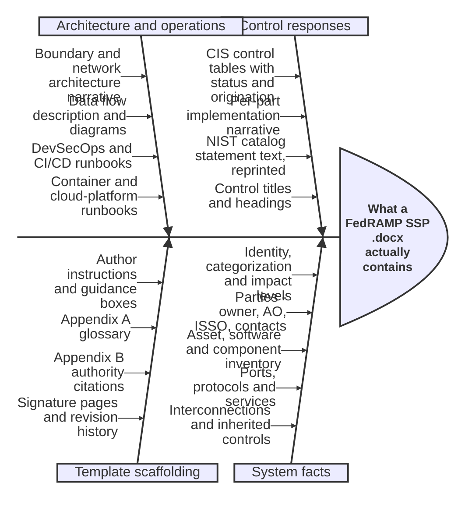
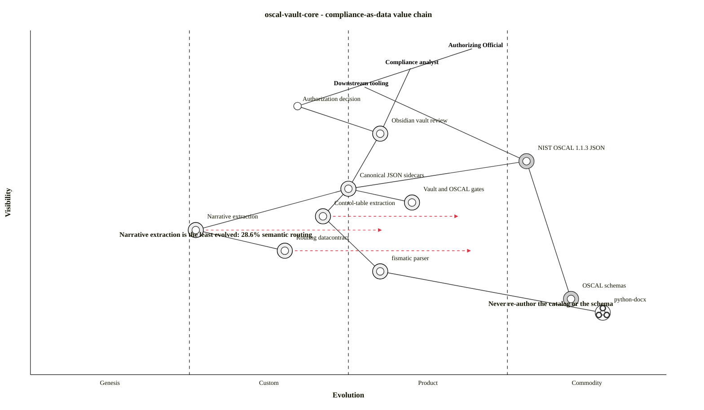
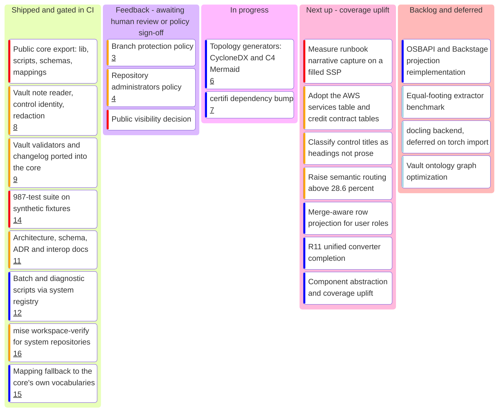
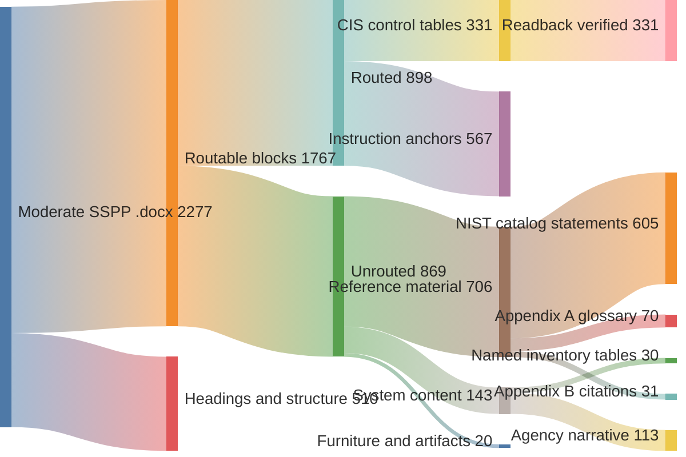

# oscal-vault-core

Turn real-world FedRAMP System Security Plan (SSP) `.docx` documents into a
navigable **Obsidian knowledge vault** and validated **NIST OSCAL** JSON.

`oscal-vault-core` parses the messy, human-authored Word tables and narrative of
a FedRAMP SSP and produces:

- an **Obsidian vault** of typed, cross-linked markdown notes
  (`oscal.*` / `oscal.x.*` / `okf.*` — controls, system, components, parties,
  boundaries, diagrams, decisions, …);
- deterministic, hash-stable **canonical JSON** sidecars;
- strict, schema-valid **NIST OSCAL 1.1.3** system-security-plan JSON.

It is public-domain (CC0) and focused on one pipeline:

```text
FedRAMP SSP (.docx)
        │  fismatic (primary control-table parser)
        │  + heading_parser (contract-driven Chapters 1-12 narrative)
        ▼
OSCAL SSP dict  ──►  Obsidian vault (markdown + media)
                          │  generate_canonical_json.py
                          ▼
                     canonical JSON (.snapshots/current/)
                          │  export_oscal.py
                          ▼
                     NIST OSCAL 1.1.3 JSON  (schema-validated)
```

## What is actually inside an SSP

A FedRAMP SSP is not one kind of content, and that is the whole problem. Four
categories arrive in the same Word file, and each wants a different
disposition: capture it, reference it, or decline it. Measuring "how much did
we extract" without first asking "extract *what*" produces a number nobody can
act on.



**Control responses** and **system facts** are what the pipeline exists to
capture. **Architecture and operations** is the largest body of genuinely
system-specific prose and the least evolved part of the extraction.
**Template scaffolding** is boilerplate: identical across every SSP built from
the same baseline, and deliberately not carried forward.

The coverage numbers further down are only meaningful against this breakdown —
see [`docs/DROPPED_CONTENT_DISPOSITION.md`](docs/DROPPED_CONTENT_DISPOSITION.md)
for the per-class decision.

## Navigation

| Start here                                                                         | For                                                                      |
| ---------------------------------------------------------------------------------- | ------------------------------------------------------------------------ |
| [`docs/ARCHITECTURE.md`](docs/ARCHITECTURE.md)                                     | Diagram-first tour of the whole pipeline, and every CLI entry point      |
| [`docs/DATA_FLOW.md`](docs/DATA_FLOW.md)                                           | Artifact-level trace: extraction → vault → sidecars → OSCAL             |
| [`docs/INTEROPERABILITY.md`](docs/INTEROPERABILITY.md)                             | How FedRAMP SSP ↔ ODCS datacontract ↔ OSCAL map, and how loss is measured |
| [`docs/OBSIDIAN_VAULT_SCHEMA.md`](docs/OBSIDIAN_VAULT_SCHEMA.md)                   | Every note type and its frontmatter contract                             |
| [`docs/VAULT_VALIDATION.md`](docs/VAULT_VALIDATION.md)                             | What each validator enforces and how debt baselines work                 |
| [`docs/CROSSWALK_COVERAGE.md`](docs/CROSSWALK_COVERAGE.md)                          | Per-OSCAL-model coverage matrix, including what is *not* covered         |
| [`docs/DROPPED_CONTENT_DISPOSITION.md`](docs/DROPPED_CONTENT_DISPOSITION.md)        | What the unrouted blocks actually are, and whether to adopt or decline each |
| [`docs/ADR/README.md`](docs/ADR/README.md)                                          | 27 architecture decision records, with status                             |
| [`docs/PARSING_ACCURACY_NOTES.md`](docs/PARSING_ACCURACY_NOTES.md)                 | Known extraction failure modes                                            |
| [`compliance/README.md`](compliance/README.md)                                      | The pipeline package itself                                               |
| [`CONTRIBUTING.md`](CONTRIBUTING.md) · [`SECURITY.md`](SECURITY.md)                 | Workflow, and how to report a vulnerability                               |

## Project goals — what is commodity, and what is still bespoke

This repository exists to make compliance evidence *data* rather than prose.
The strategic question is which parts of that are already solved and which are
still hand-built. Components to the left are novel and ours to own; to the right
they are inherited or bought.



Reading it as strategy:

- **Narrative extraction is the bottleneck.** It is furthest left and most
  hand-built, and the measured numbers below agree: 28.6% semantic routing.
- **The OSCAL schemas are a commodity — buy them.** They are vendored from NIST
  and validated against, never re-authored.
- **The control-table parser is ours.** `fismatic/` began as the U.S. Census
  Bureau's public-domain parser and has since been substantially rewritten and
  extended here — 719 lines and 25 functions in `parser.py` alone, covering
  checkbox-state parsing, control-ID normalization, origination-to-OSCAL
  mapping, contract-driven configuration, and part-row extraction the original
  did not have. We own and maintain it. `python-docx` underneath it is the only
  genuinely off-the-shelf piece.
- **The gates are the product.** The validators and the canonical-JSON layer are
  what make any of the output reviewable, and they are what this repository
  intends to keep building.

## Roadmap — milestones by completion status

The **feedback** lane is the important one: it holds work that is implemented
but cannot advance without a human policy or review decision. Nothing moves out
of it on a CI result.



Each lane has a governing document. Use these for the detail the card titles
cannot carry:

| Lane         | Governing document                                                                  | What it decides                                              |
| ------------ | ----------------------------------------------------------------------------------- | ------------------------------------------------------------ |
| Shipped      | [`docs/ADR/README.md`](docs/ADR/README.md)                                           | Why each landed decision was made, and what it superseded    |
| **Feedback** | [`SECURITY.md`](SECURITY.md) · repository settings                                   | Visibility and protection are human governance decisions     |
| In progress  | [`docs/ADR/ADR-027-topology-generators-cyclonedx-c4.md`](docs/ADR/ADR-027-topology-generators-cyclonedx-c4.md) · [`docs/rubrics/`](docs/rubrics/) | Topology generators, still `Proposed (feasibility build)` |
| Next up      | [`docs/DROPPED_CONTENT_DISPOSITION.md`](docs/DROPPED_CONTENT_DISPOSITION.md) · [`docs/CROSSWALK_COVERAGE.md`](docs/CROSSWALK_COVERAGE.md) · [`docs/plans/`](docs/plans/) | Which unrouted content to adopt, which to decline, and in what order |
| Backlog      | [`docs/SUGGESTIONS_AND_IMPROVEMENTS.md`](docs/SUGGESTIONS_AND_IMPROVEMENTS.md) · [`docs/osbapi-backstage-interop/`](docs/osbapi-backstage-interop/) | Deferred projections and research harnesses |

## `.docx` → vault → OSCAL — what the transformation actually loses

Most of a FedRAMP SSP `.docx` does **not** reach the vault, and being honest
about that is the point of the coverage harness. Numbers below are a live run of
`compliance/scripts/docx_coverage_metrics.py` against the committed blank
**Moderate** template — reproduce them with:

```bash
uv run python compliance/scripts/docx_coverage_metrics.py \
  --docx "templates/Moderate-SSPP-Template-[Contains-CUI]-10-16-2024.docx"
```



What the widths mean:

- **The unrouted 869 is not one thing.** Classified by what each block actually
  is: **706 blocks (89,155 chars, 77%) are reference material** — NIST catalog
  statement text reprinted into Word, the Appendix A glossary, the Appendix B
  citation list. All of it is authoritative somewhere this project already
  vendors. Only **143 blocks (25,620 chars, 22%) are system content**: the named
  inventory tables and the agency's own prose.
- **604 of 608 control-section prose blocks — 99.3% — match a NIST catalog
  statement.** Re-storing them would create a drifting second copy of text the
  repository validates against. See
  [`docs/DROPPED_CONTENT_DISPOSITION.md`](docs/DROPPED_CONTENT_DISPOSITION.md)
  for the per-class adopt / reference / decline proposal.
- Structural node coverage is 50.8%; semantic-domain routing is **28.6%**
  (6 of 21 domains). All 21 domains are *present*; only 6 are reached by an
  extractor that produces structured output.
- **What does route, routes losslessly.** All 331 detected CIS control tables
  read back without error — 100% readback fidelity — and package-part coverage
  is 100%.
- **Part narratives are the visible gap.** 155 of 331 controls expose part rows,
  and only 57 of 520 part-narrative slots are filled in the blank template.
  A real SSP fills far more; the blank template is the floor, not the ceiling.
- **Headings and structure are not a loss.** Those 510 blocks are document
  scaffolding with no control semantics to carry.

Reproduce the disposition split with
`compliance/scripts/classify_dropped_blocks.py`.

### The pipeline as a grammar

The same transformation stated as an ABNF grammar — useful when you need to know
which stages are optional, which alternate, and where the gates sit. Every
terminal is a real script, contract, or artifact path in this repository.

```mermaid
railroad-abnf-beta
title "oscal-vault-core: .docx to validated OSCAL"

pipeline = intake extract build gate export ;

intake = "FedRAMP SSP .docx" ;

extract = controls narrative ;
controls = "fismatic.SSPConverter" ;
narrative = "heading_parser" "compliance/datacontracts/fedramp-ssp-v1.yaml" ;

build = vault sidecars ;
vault = "export_obsidian_vault.py" ;
sidecars = "generate_canonical_json.py" ;

gate = 1*check ;
check = frontmatter / wikilinks / dataview / cui / mappings ;
frontmatter = "validate_frontmatter.py" ;
wikilinks = "validate_wikilinks.py" ;
dataview = "validate_dataview_queries.py" ;
cui = "validate_cui_contracts.py" ;
mappings = "validate_oscal_mappings.py" ;

export = "export_oscal.py" [ validate ] [ fillback ] ;
validate = "validate_oscal.py --semantic --parity" ;
fillback = "fill_ssp_from_oscal.py" "compliance/templates/*.jinja.docx" ;
```

Read the grammar as the contract:

- `gate` is **`1*check`** — at least one, and in practice all of them. There is
  no path from a `.docx` to an exported OSCAL document that skips validation.
- `extract` is a **concatenation, not a choice**. Control tables and narrative
  are two different extractors over the same document; dropping either loses a
  whole class of content.
- `validate` and `fillback` are optional *only* in the sense that export can
  emit JSON without them. A reviewed artifact runs both.
- `intake` has no alternative. This repository holds no system content, so the
  `.docx` always comes from the caller.

## Quickstart (mise)

Managed with [`mise`](https://mise.jdx.dev/) and its pinned toolchain:

```bash
# Install the pinned toolchain and locked dependencies.
mise install
mise run setup

# Run all CI gates (lint, audit, security, and synthetic tests).
mise run verify

# Build a vault from a FedRAMP SSP .docx you supply locally
mise exec -- uv run python compliance/scripts/export_obsidian_vault.py \
  --docx path/to/your-ssp.docx \
  --plan-id my-system-2026 \
  --system-name "My System" --fips-199 low \
  --metadata-yaml scripts/registry.yaml \
  --vault examples/vault/my-system-2026/

# Regenerate canonical JSON sidecars, then export + validate OSCAL
mise exec -- uv run python compliance/scripts/generate_canonical_json.py --vault examples/vault/my-system-2026/
mise exec -- uv run python compliance/scripts/export_oscal.py --vault examples/vault/my-system-2026/ --validate
```

### Running the gates against a system repository

The core holds no system content. To run its gates over a repository that does,
run the harness **from that repository**:

```bash
cd /path/to/my-system-repo
OSCAL_VAULT_WORKSPACE="$PWD" mise -C /path/to/oscal-vault-core run workspace-verify
```

It expects `./examples/vault/<system>/` and, optionally, baseline files under
`./scripts/`. A gate whose baseline is absent reports `SKIPPED` rather than
passing silently, and the exit code is non-zero if any gate that ran failed.

## Directory layout

| Path                                  | Purpose                                                                                                     |
| ------------------------------------- | ----------------------------------------------------------------------------------------------------------- |
| `fismatic/`                           | The primary FedRAMP SSP `.docx` → OSCAL SSP control-table parser. Originated as the Census Bureau's FISMAtic; rewritten and maintained here. |
| `compliance/lib/`                     | Core library (56 modules): vault builders, contract-driven `heading_parser`, OSCAL export, canonical JSON, validators. |
| `compliance/scripts/`                 | 54 CLIs: `export_obsidian_vault.py`, `generate_canonical_json.py`, `export_oscal.py`, `validate_*.py`, coverage and roundtrip tools. |
| `compliance/scripts/classify_dropped_blocks.py` | Classifies every unrouted block by what it is, so the loss budget can be adopted or declined per class. |
| `mise run workspace-verify` | Runs the core's gates against a system repository named by `OSCAL_VAULT_WORKSPACE`. |
| `compliance/datacontracts/`           | ODCS v3.1.0 routing contract (`fedramp-ssp-v1.yaml`) + roundtrip fill-back contracts.                        |
| `compliance/mappings/`                | Vocabulary crosswalk tables (raw → normalized status/origination enums), with a built-in fallback.          |
| `compliance/schemas/`                 | Vendored NIST OSCAL 1.0.4 / 1.1.3 schemas (Layer-1 validation).                                              |
| `compliance/data/`                    | NIST 800-53 Rev. 5 control names, statements, parameter labels, FedRAMP baselines, D3FEND mapping.           |
| `compliance/templates/*.jinja.docx`   | Committed docxtpl templates for the OSCAL → `.docx` roundtrip (no CUI).                                      |
| `compliance/tests/`                   | 69 test modules covering the pipeline, on synthetic fixtures.                                                |
| `templates/`                          | The official **blank** GSA Low / Moderate / High SSPP templates (no CUI) — see ADR-021.                      |
| `tests/`                              | Public-core governance and OSCAL-source checks.                                                              |
| `vault-schemas.json`                  | JSON Schema `$defs` for every vault note's frontmatter (used by the validators).                             |
| `skills/c4-mermaid/`                  | Agent skill playbook for the C4 topology generator.                                                          |
| `docs/`                               | Architecture, data flow, interoperability, vault schema, crosswalk coverage, 27 ADRs, plans, rubrics.        |
| `docs/osbapi-backstage-interop/`      | OSBAPI / Backstage projection modeling guidance (future interoperability; see below).                        |

## No source `.docx` files are committed

This repository **never commits FedRAMP SSP `.docx` source files** — they are
often sensitive, large, and not ours to redistribute. `*.docx` is excluded
repo-wide via `.gitignore`, with two deliberate exceptions: the CUI-free blank
GSA templates under `templates/` (ADR-021) and the `*.jinja.docx` roundtrip
templates under `compliance/templates/`.

Consequently:

- Tests that need a real `.docx` fixture **skip gracefully** rather than fail.
  The suite is 987 passing tests with no source document present.
- CI validates the parser and control-table behaviour, and renders synthetic
  sentinels through the blank Low, Moderate, and High templates.
- To build a vault from scratch, supply your own SSP `.docx` (or use one of the
  committed blank baselines) and point the CLI at it.
- **No example vault is committed here.** A generated vault belongs to the
  system repository that owns the content; use `mise run workspace-verify` with
  `OSCAL_VAULT_WORKSPACE` to validate one in place.

## OSBAPI / Backstage interoperability (recommended projection)

The vault's normalized `normalized_status` / `normalized_origination` control
vocabulary is deliberately aligned with the
[OSBAPI](https://oscal-project.github.io/) CRM profile so the exported OSCAL can
be projected into an Open Service Broker API summary or a Backstage catalog
entity. That projection is documented as **modeling guidance** under
[`docs/osbapi-backstage-interop/`](docs/osbapi-backstage-interop/) and the
[`vault-schemas.json`](vault-schemas.json) `$defs` (`OscalCrmSummary`,
`BackstageEntityComplianceEnvelope`, `ComplianceAdapterEntityResponse`). The
earlier generator scripts for it are not part of this core, pending a
datacontract-driven reimplementation; the schemas and docs remain the source of
truth for future interoperability work.

## Validation

CI (`.github/workflows/validate.yml`) runs on every pull request and on pushes
to `main`:

| Gate                                                            | What it proves                                              |
| --------------------------------------------------------------- | ----------------------------------------------------------- |
| `mise run setup`                                                | Pinned toolchain and locked dependencies                    |
| `mise run lint`                                                 | Lint and formatting (ADR-004 scopes ruff to `compliance/`) |
| `mise run audit` / `mise run security`                          | Dependency and static security checks                       |
| `mise run test`                                                 | Synthetic tests; no source `.docx` required                 |

The core validates its own parser and control-table behaviour. System
repositories validate their own restricted content separately; **no system
content is required by this repository's CI.**

## License

This project is dedicated to the public domain under
[CC0 1.0 Universal](https://creativecommons.org/publicdomain/zero/1.0/) — see
[`LICENSE.md`](LICENSE.md). It originates from GSA public-domain work.

## Acknowledgements

The control-table parser under `fismatic/` originated as
**[FISMAtic](https://github.com/uscensusbureau/fismatic)** (U.S. Census Bureau,
public domain) and we are grateful for the starting point. It has since been
substantially rewritten and extended here and is maintained as part of this
project — the name is kept for provenance, not to imply the upstream code is
still what runs. It remains the sole live control-table extractor in the
pipeline.
