<!-- Diagrams use GitHub-flavored mermaid. They render on github.com and in the
     Obsidian vault (Mermaid is built in). Keep node labels ASCII-safe. -->

# Architecture & Workflow Reference

> **Where things live.** This repository (`oscal-vault-core`) holds the code, schemas, mappings, tests and
> documentation. A *system repository* holds one system's generated vault (`examples/vault/<system>/`), its
> committed snapshots (`.snapshots/`) and its per-system metadata (`scripts/registry.yaml`). Paths below that
> start with `examples/`, `.snapshots/` or `scripts/registry.yaml` refer to the system repository, and the scripts
> in `compliance/scripts/` read them from the directory they are run in.

This document is the single, diagram-first map of how a real-world FedRAMP
System Security Plan (SSP) `.docx` becomes validated, machine-readable
artifacts: an **Obsidian knowledge vault**, **canonical JSON sidecars**,
**strict NIST OSCAL JSON**, and the **OSBAPI / Backstage** projections that
were the original purpose of the fork.

For a focused artifact-level trace from extraction through vault markdown,
canonical sidecars, and OSCAL exports, see
[`docs/DATA_FLOW.md`](DATA_FLOW.md).

- [1. Intent](#1-intent) — why this project exists
- [2. System context](#2-system-context) — the pieces and how they relate
- [3. End-to-end workflow](#3-end-to-end-workflow) — the full pipeline
- [4. Scripts & commands](#4-scripts--commands) — every CLI entry point
- [5. Extraction techniques](#5-extraction-techniques) — how the `.docx` is read
- [6. Configuration & reference](#6-configuration--reference) — the knobs
- [7. Type taxonomy](#7-type-taxonomy) — `oscal.*` / `oscal.x.*` / `okf.*`
- [8. Output structure & files](#8-output-structure--files) — what lands on disk
- [9. Validation](#9-validation) — the gates
- [10. Benchmarks](#10-benchmarks) — extractor comparison
- [11. File & directory reference](#11-file--directory-reference)

---

## 1. Intent

The repository is a narrowly-scoped fork of
[GSA/fedramp-automation](https://github.com/GSA/fedramp-automation). It does
**one thing**: turn messy, human-authored FedRAMP SSP `.docx` documents into
validated, structured, machine-consumable compliance data — without the parent
repo's Schematron/XML build system.

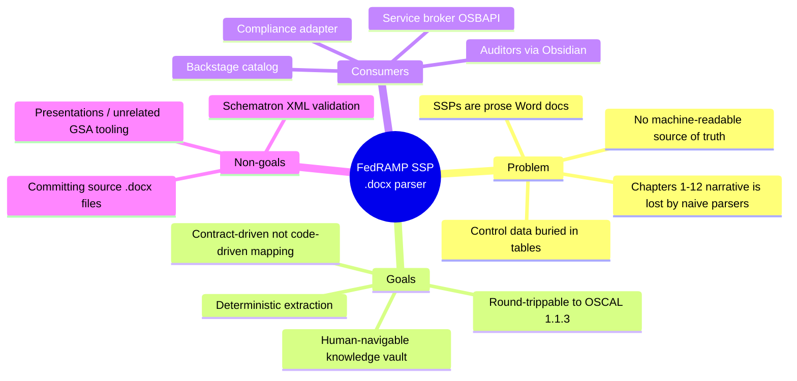

**Priority order** (inherited from the federal agent contract):
`safety > correctness > compliance > simplicity > performance`. Determinism is
prized over cleverness — the same `.docx` should produce the same artifacts so
diffs are meaningful (the one intentional exception is per-run random
`system_id`/uuid seeds).

---

## 2. System context

Two output "flavors" share the same extraction core:

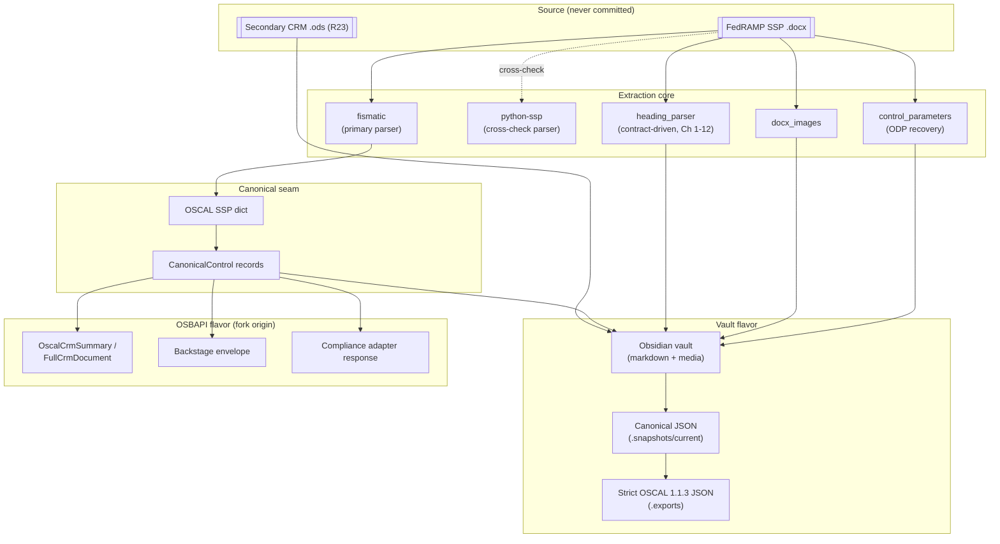

> **Note:** only `fismatic` is wired into the live pipeline. `python-ssp` was
> an independent second reader retained for cross-checking; it is not part of
> this core. The OSBAPI/Backstage projection (dashed, right) is the
> fork's original purpose and is now **recommended modeling only** — the
> generator scripts are not part of this core either, and the projection is
> documented in `docs/osbapi-backstage-interop/` with its schemas in
> `vault-schemas.json`.

---

## 3. End-to-end workflow

### 3.1 The `.docx → vault` sequence

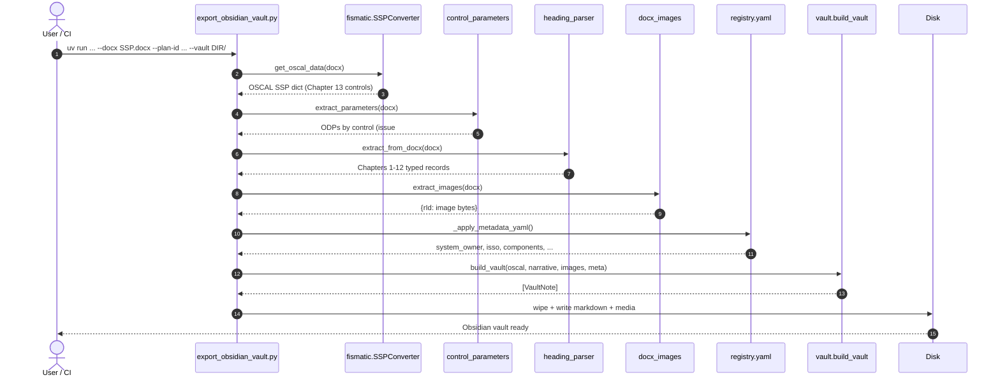

### 3.2 The four-layer data model (ADR-002 / ADR-012)

Each layer has a distinct commit policy, which is what keeps the git history
clean and the exports reproducible:

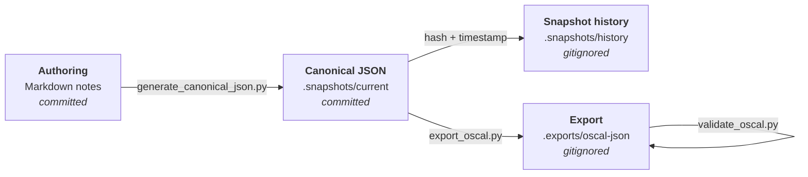

---

## 4. Scripts & commands

Bootstrap and verify are one command each — there is no `Makefile`; `uv` is the
task runner.

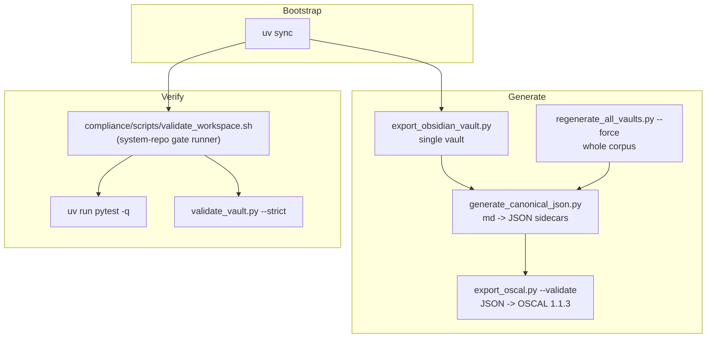

### 4.1 Command reference

| Command | Purpose |
|---|---|
| `uv sync` | Install all dependencies; prepare environment (bootstrap). |
| `uv run pytest -q` | Full test suite (skips gracefully without `.docx` fixtures). |
| `bash <core>/compliance/scripts/validate_workspace.sh` | Run every gate against a **system repository** (run it from there). A gate whose baseline file is absent reports `SKIPPED`. |
| `uv run python3 compliance/scripts/export_obsidian_vault.py …` | Build one vault from a `.docx` (or `--oscal-json`). |
| `uv run python3 <core>/compliance/scripts/regenerate_all_vaults.py --force` | Rebuild every registered system's vault. |
| `uv run python3 compliance/scripts/generate_canonical_json.py [--vault DIR] [--note PATH]` | Emit canonical JSON sidecars; repeat `--note` for targeted, no-clean regeneration. |
| `uv run python3 compliance/scripts/export_oscal.py --validate [--oscal-version 1.1.3]` | Emit strict NIST OSCAL JSON into `.exports/oscal-json/`. |
| `uv run python3 compliance/scripts/validate_vault.py [--strict]` | Headless "open in Obsidian" — frontmatter, wikilinks, dataview, orphans, OKF conformance. |
| `uv run python3 compliance/scripts/benchmark_extractors.py` | Run the 5 extractor backends over the corpus. |

### 4.2 Canonical single-vault invocation

```bash
uv run python3 compliance/scripts/export_obsidian_vault.py \
  --docx <ssp>.docx \
  --plan-id <system> \
  --system-name "<System Name>" \
  --fips-199 low \
  --metadata-yaml scripts/registry.yaml \
  --vault examples/vault/<system>/
```

Key flags: mutually-exclusive `--docx | --oscal-json`; `--plan-id` (req);
`--vault` (req); `--parser-name` (default `fismatic`); `--fips-199 {low,moderate,high}`;
`--metadata-yaml`; `--crm-ods`; `--keep-existing`; `--source-docx`.

---

## 5. Extraction techniques

The parser is a **dual-extractor** design (ADR-008): a hand-tuned primary
parser for the control tables in Chapter 13, and a contract-driven secondary
parser for the narrative Chapters 1-12 that naive parsers drop.

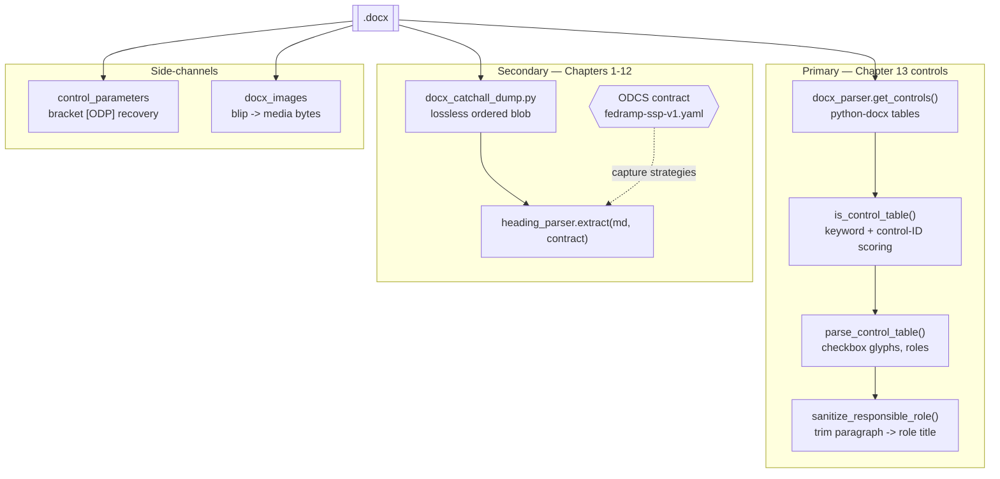

### 5.1 Capture strategies (contract-driven)

The secondary parser routes each destination property through a named
strategy declared in the ODCS contract — **adding a mapping is a contract edit,
not a code change**:

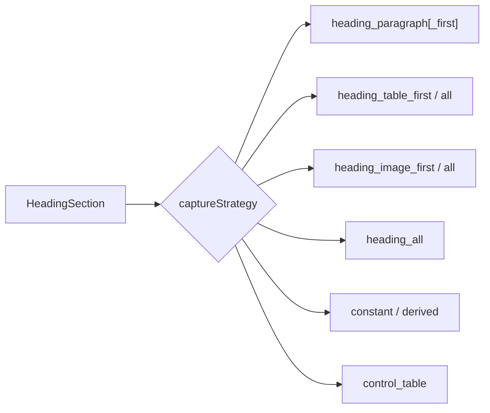

Heading matching supports exact, section-number-stripped, `prefix*`,
`regex:` patterns, plus `aliasSourceHeading` (R14).

### 5.2 Checkbox & vocabulary normalization

FedRAMP CIS tables encode Implementation Status / Control Origination as
checkbox glyphs. The parser recognizes `☒ ✓ ⊠`, `[x]`, and bare `x`, then maps
raw text to OSCAL vocab via data-only crosswalk files:

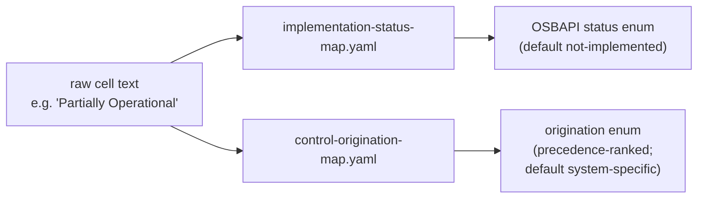

### 5.3 Pluggable benchmark backends

For measurement, extraction is abstracted behind an `ExtractorBackend`
protocol that normalizes any engine to `ExtractedDoc(headings, paragraphs,
tables, images)`:

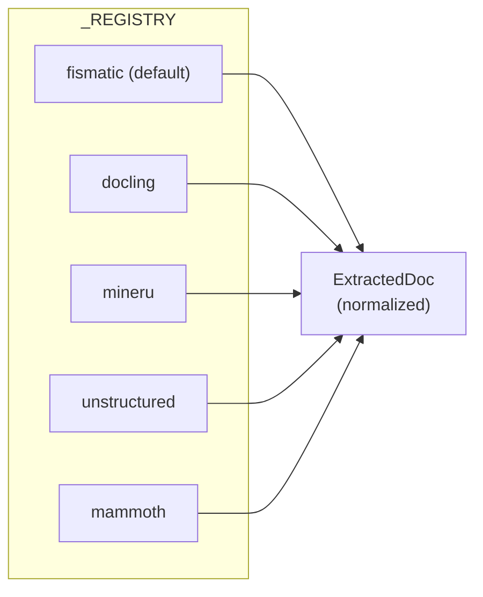

---

## 6. Configuration & reference

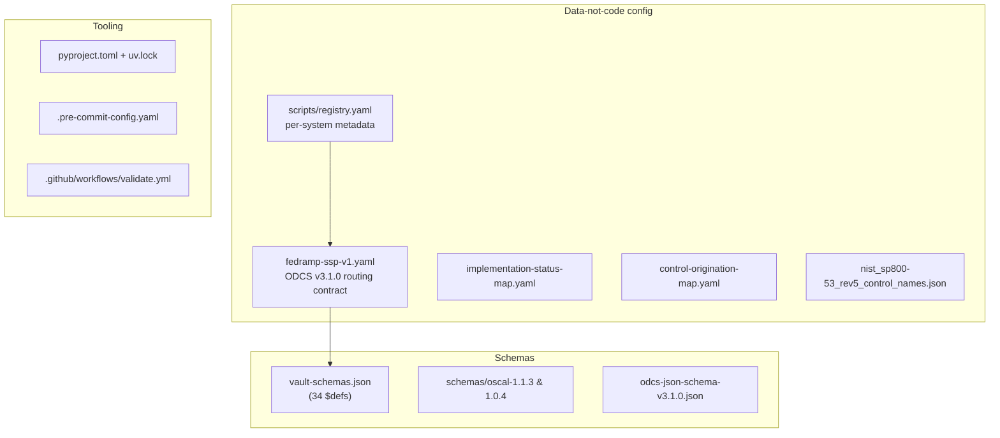

**Key configurable knobs**

| Knob | Where | Effect |
|---|---|---|
| Parser choice | `--parser-name` | `fismatic` (default) vs alternatives. |
| FIPS level | `--fips-199` | Drives roundtrip contract + impact fields. |
| Per-system metadata | `scripts/registry.yaml` | Owner, ISSO, AO, components fismatic can't extract. |
| Routing / mappings | `fedramp-ssp-v1.yaml` | 19 objects, 116 `sourceHeading`s; add a mapping without touching code. |
| Vocabulary | `mappings/*.yaml` | raw → OSCAL/OSBAPI enums + precedence. |
| OSCAL version | `--oscal-version` | `1.1.3` (default) or `1.0.4`. |
| Primary vs contract control extraction | `handledByPrimaryParser` (contract) | Whether fismatic or the contract handles a control object. |

---

## 7. Type taxonomy

Three namespaces classify every note (defined in `compliance/lib/vault.py`,
`docs/OBSIDIAN_VAULT_SCHEMA.md`, ADR-001; validated by
`scripts/validate_frontmatter.py`):

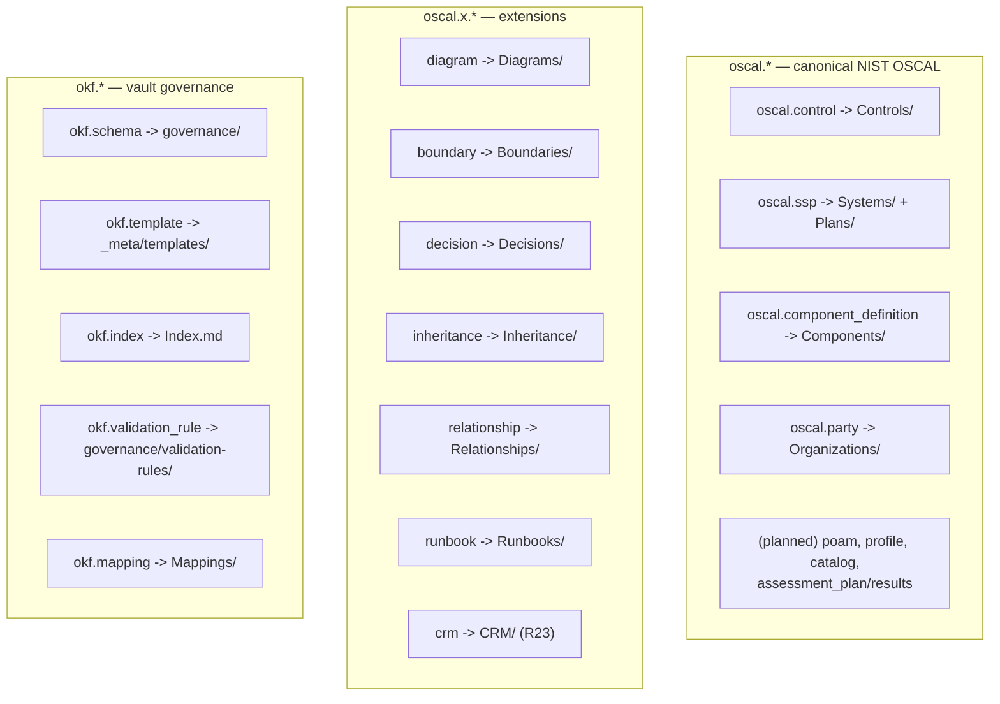

Sub-typing via `*_kind` fields (ADR-010) prevents ontology creep — e.g.
`oscal.x.decision.decision_kind ∈ {decision, assumption, exception}`.
Canonical notes carry `oscal_model + kind: canonical`; extensions carry
`extension_model + kind: extension`; system-scoped notes carry `system_id`.

---

## 8. Output structure & files

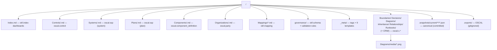

Two committed generations live under `examples/vault/` (19 vaults total): a
**basic / fismatic-only** set (control tables only) and a **rich /
docx-narrative** set (dated names) that also carries the `oscal.x.*` narrative
folders and extracted diagram images.

Canonical JSON sidecars embed a `_meta` block with a `sha256` content hash,
`generated_at`, `generated_from`, and `schema_version`, plus `body_sections`,
`inline_fields`, and flattened frontmatter.

---

## 9. Validation

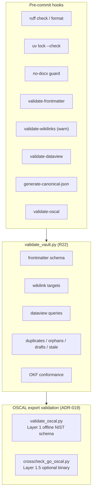

Error-level checks fail closed; structural/ported checks warn unless
`--strict`. CI (`.github/workflows/validate.yml`) runs
`uv sync --frozen → ruff check → ruff format --check → pytest (966 tests) →
the slow synthetic-sentinel roundtrip`. It needs no system content: the vault
and OSCAL gates above run in a **system repository** through
`compliance/scripts/validate_workspace.sh`.

---

## 10. Benchmarks

All five backends reach parity on headings/tables/images; they differ on speed

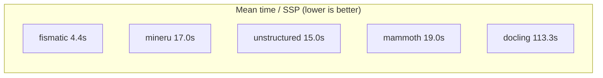

| Backend | Mean time | Headings | Tables | ¶ | 🖼 | Pick when you need |
|---|---:|---:|---:|---:|---:|---|
| `fismatic` | **4.4s** | 658 | 2,578 | 14,860 | 92 | Speed / determinism / diffs |
| `docling` | 113.3s | 677 | 2,580 | 65,394 | **100** | Most images |
| `mineru` | 17.0s | **1,102** | 2,568 | 18,203 | 98 | Most headings (H5/H6) |
| `unstructured` | 15.0s | 657 | 2,578 | 15,491 | 92 | General-purpose baseline |
| `mammoth` | 19.0s | 648 | 2,578 | **84,307** | 93 | Most granular paragraphs / small install |

Contract coverage sits at **66.9% mean fill rate** (R14 baseline); the R15
work improved backend quality, not contract breadth. Coverage-gap ranking is
driven by `scripts/coverage_gap_analysis.py`, which ranks uncaptured headings
against the contract's `sourceHeading` set.

---

## 11. File & directory reference

| Path | Role |
|---|---|
| `fismatic/src/phase_1/fismatic/` | Primary `.docx → OSCAL SSP` parser (`docx_parser.py`, `parser.py`, `ssp_converter.py`). |
| `compliance/lib/` | Core: `vault.py`, `export_oscal.py`, `heading_parser.py`, `control_parameters.py`, `docx_images.py`, `canonical_model.py`, `canonical_json.py`, `oscal_source.py`, `extractor_backend.py`. |
| `compliance/scripts/` | Generation CLIs (`export_obsidian_vault.py`, `generate_canonical_json.py`, `export_oscal.py`, `validate_oscal.py`, `benchmark_extractors.py`). |
| `compliance/datacontracts/` | ODCS routing contract + roundtrip contracts + ODCS schema. |
| `compliance/mappings/` | Vocabulary crosswalk YAMLs. |
| `compliance/data/` | NIST Rev 5 control names, statements, parameter labels, FedRAMP baselines, D3FEND mapping. |
| `compliance/schemas/` | Vendored NIST OSCAL schemas (1.1.3, 1.0.4). |
| `compliance/tests/` | pytest suite + fixtures. |
| `templates/` | The official **blank** GSA Low / Moderate / High SSPP templates (no CUI) — see ADR-021. |
| `tests/` | Public-core governance and OSCAL-source checks. |
| `skills/c4-mermaid/` | Agent skill playbook for the C4 topology generator. |
| `examples/vault/` | Where a **system repository** keeps its generated vault. Nothing is committed here; this repository holds no system content. |
| `docs/rubrics/`, `docs/plans/` | Generator evaluation rubric and active increment plans. |
| `docs/` | `ARCHITECTURE.md`, `INTEROPERABILITY.md`, reference docs, `ADR/`, `osbapi-backstage-interop/`. |
| `vault-schemas.json` | The `$def` schema suite every vault note + projection validates against. |
| `compliance/scripts/validate_workspace.sh` | Runs every gate against a system repository, from that repository. |

---

### How to extend

- **New heading → field mapping:** edit `fedramp-ssp-v1.yaml` (a
  `sourceHeading` + `captureStrategy`), no code change.
- **New vocabulary value:** edit the relevant `mappings/*.yaml`.
- **New system:** add an entry to `scripts/registry.yaml`, then run
  `regenerate_all_vaults.py`.
- **Architecture change:** open an ADR (see `docs/ADR/`) before altering module
  boundaries, dependencies, or data classification.
