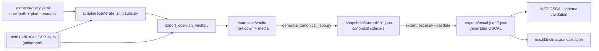
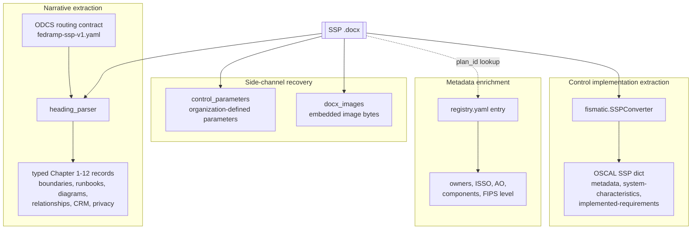
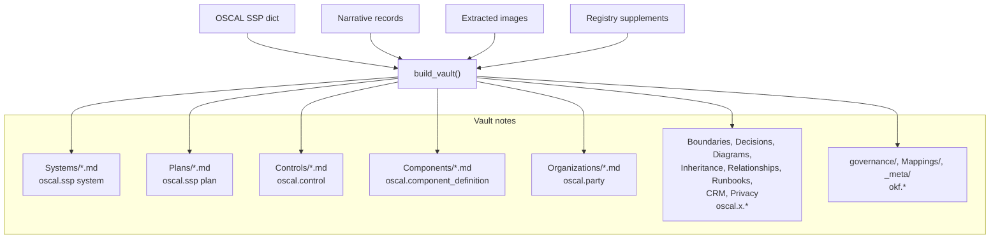
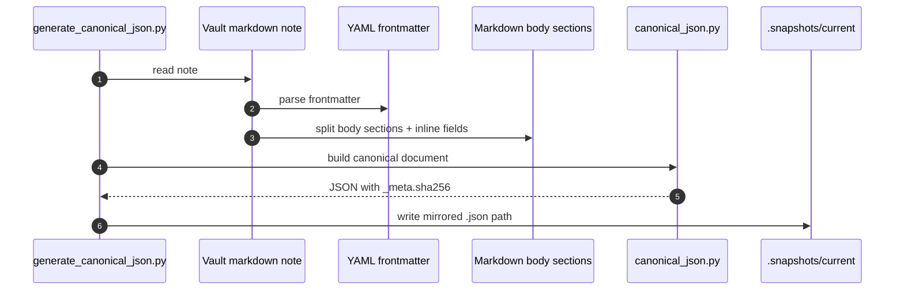
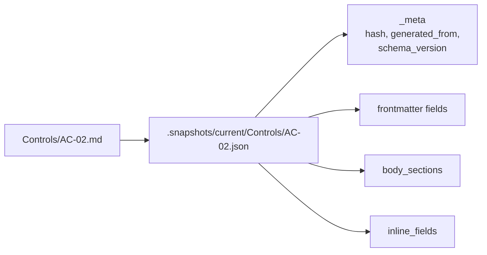
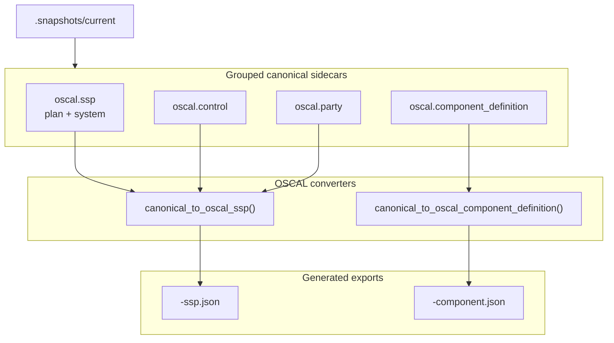
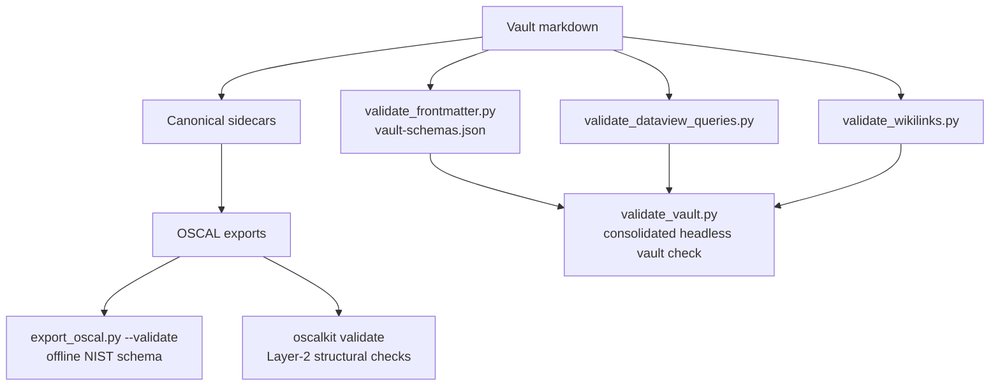
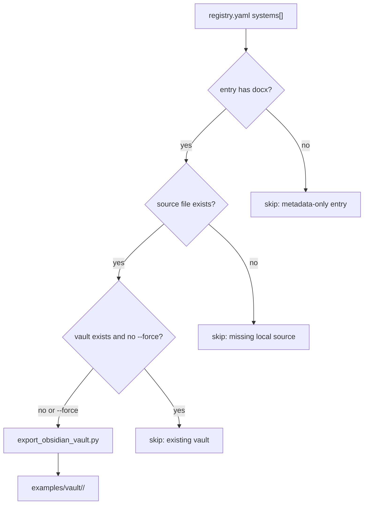

# Extraction to Vault to OSCAL Data Flow

This document follows the data, not just the commands. It describes how a local
FedRAMP SSP `.docx` source is extracted, enriched, written as an Obsidian vault,
converted to canonical JSON sidecars, and exported as NIST OSCAL JSON.

Source `.docx` files remain local and gitignored. The committed artifacts are
the derived vault markdown, extracted media, and canonical `.snapshots/current`
JSON sidecars. Generated OSCAL exports under `.exports/oscal-json/` are
reproducible and gitignored.

## End-to-End Artifact Flow

The registry is now the batch source of truth. Each entry with a `docx` field is
eligible for regeneration; missing source documents are skipped so a clean clone
can still validate the already committed derived artifacts.

## Extraction Stage

`export_obsidian_vault.py` orchestrates four extraction channels before calling
the vault builder.

The fismatic parser is the primary live extractor. The heading parser fills the
gap left by table-only parsing by routing prose and tables from Chapters 1-12
into typed extension notes.

## Vault Build Stage

`compliance/lib/vault.py` converts extracted data into typed notes. Frontmatter
is the machine-readable index; markdown bodies remain human-reviewable in
Obsidian.

Generated relationship fields connect notes as a navigable graph and are
validated by `vault-schemas.json`:

| Field | Emitted on | Meaning |
| --- | --- | --- |
| `up_plan` | `Systems/*.md` | Parent SSP plan for the system. |
| `child_components` | `Systems/*.md` | Components belonging to the system. |
| `child_systems` | `Plans/*.md`, `Organizations/*.md` | Systems described by a plan or owned by an organization. |
| `child_controls` | `Plans/*.md` | Controls implemented under the plan. |
| `up_system` | `Components/*.md` | Owning system for a component. |

## Canonical Snapshot Stage

`generate_canonical_json.py` reads vault markdown as the source of truth and
emits deterministic JSON sidecars under `.snapshots/current/`.

Canonical sidecars preserve the note shape while making it easy for scripts to
consume vault content without reparsing markdown every time.

## OSCAL Export Stage

`export_oscal.py` groups canonical JSON sidecars by `type` and emits strict
OSCAL documents.

The SSP export is assembled from multiple vault note types: plan metadata,
system characteristics, control implementations, and party/responsible-role
metadata. Component-definition exports are generated separately from component
notes.

## Validation Gates

The same flow is checked at multiple layers so a generated note graph can be
reviewed before trusting its OSCAL export.

Current non-strict vault warnings are informational review targets, not export
blockers: orphan extension notes, draft markers from source/template text, and
thin generated organization notes. Error-level checks fail the pipeline.

## Batch Regeneration Contract

The batch script intentionally skips missing `.docx` files. That keeps CI and a
fresh clone independent of source documents while still letting maintainers
regenerate the full local corpus.

## Review Checklist

When a new source document is added to the local `fismatic/` corpus:

- Add a `scripts/registry.yaml` entry with `docx`, `plan_id`, `system_name`, and `fips_199`.
- Run `uv run python3 scripts/regenerate_all_vaults.py` or `--force` when refreshing existing vaults.
- Run `uv run python3 compliance/scripts/generate_canonical_json.py`.
- Run `uv run python3 scripts/validate_vault.py` and review any warning groups.
- Run `uv run python3 compliance/scripts/export_oscal.py --validate`.
- Run `bash scripts/validate_all.sh` before opening a PR.
