<!-- Diagrams are GitHub-flavored mermaid; they render on github.com and inside
     the Obsidian vault. Keep node labels ASCII-safe. -->

# Standards Interoperability & Lossless Coverage

This document explains how three standards interoperate inside the pipeline —
**FedRAMP SSP `.docx`**, the **Open Data Contract Standard (ODCS v3.1.0)** that
routes content, and **NIST OSCAL 1.1.3** — and it states lossless coverage as
an explicit goal with a defined way to *measure* and *validate* it. Where the
current implementation falls short of lossless, the gaps are enumerated in
[§9](#9-known-lossless-coverage-discrepancies) and tracked as GitHub issues.

- [1. The three standards](#1-the-three-standards)
- [2. How the datacontract is used](#2-how-the-datacontract-is-used)
- [3. OSCAL concept → vault mapping](#3-oscal-concept--vault-mapping)
- [4. Content lifecycle: transient vs ultimate storage](#4-content-lifecycle-transient-vs-ultimate-storage)
- [5. The roundtrip back to `.docx`](#5-the-roundtrip-back-to-docx)
- [6. Lossless coverage as a goal](#6-lossless-coverage-as-a-goal)
- [7. Measuring coverage](#7-measuring-coverage)
- [8. Validating faithfulness](#8-validating-faithfulness)
- [9. Known lossless-coverage discrepancies](#9-known-lossless-coverage-discrepancies)

---

## 1. The three standards

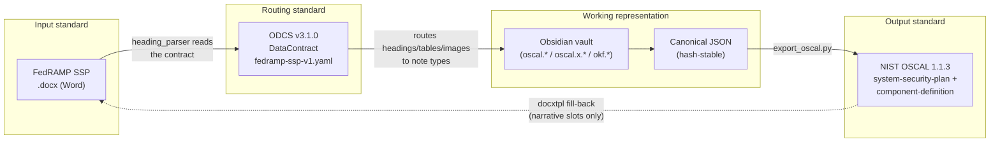

- **`.docx`** is authored by humans; control data is buried in Chapter-13
  tables and system narrative is spread across Chapters 1-12.
- **ODCS** is the *contract* that declares, as data (not code), which heading
  or table feeds which destination object and how to capture it. Adding a
  mapping is a contract edit.
- **OSCAL** is the machine-readable target that downstream consumers
  (OSBAPI, Backstage, auditors) expect.
- The **vault + canonical JSON** are the human-navigable working
  representation that sits between input and output.

---

## 2. How the datacontract is used

The contract at `compliance/datacontracts/fedramp-ssp-v1.yaml` is
**ODCS v3.1.0** (`apiVersion: v3.1.0`, `kind: DataContract`). Its `schema:`
list holds **1 source object** (`fedramp_ssp_docx`, `isSource: true`) and
**19 destination objects**. It is consumed by the secondary parser
`compliance/lib/heading_parser.py` and validated against
`compliance/datacontracts/schemas/odcs-json-schema-v3.1.0.json`.

### 2.1 The 19 destination objects

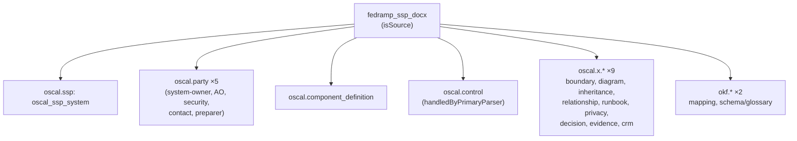

### 2.2 Object- and property-level custom properties

Each destination object carries object-level `customProperties`, and each
property carries property-level `customProperties` that drive capture:

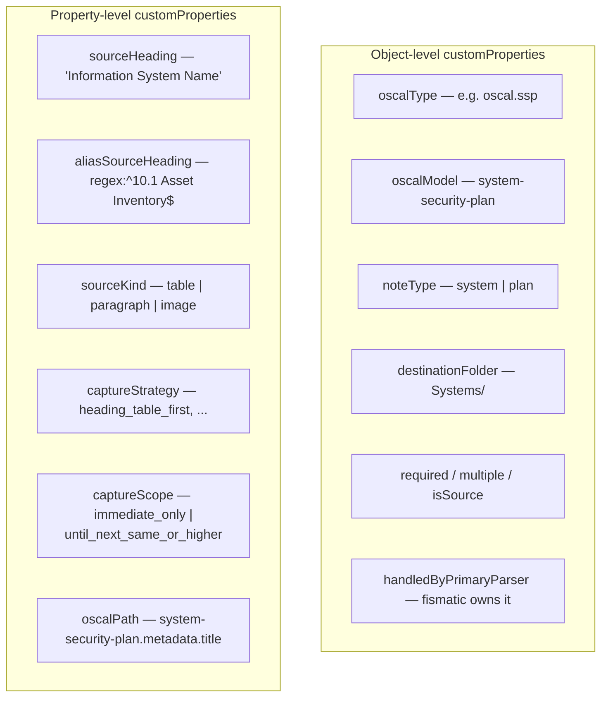

Loader mapping lives in `compliance/lib/heading_parser.py:44-54` and
`PropertyMapping` at `:180-210`.

### 2.3 Relationships (foreign keys)

Two objects declare `relationships:` — the FK graph that joins controls and
the system to the party notes:

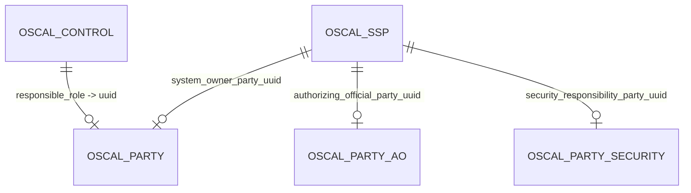

Defined at `fedramp-ssp-v1.yaml` `:751-769` (system) and `:2591-2602`
(control); parsed into `ObjectMapping.relationships`
(`heading_parser.py:117,226`).

### 2.4 `oscalPath` is a validated export claim

Every property declares an `oscalPath` pointing into the OSCAL JSON structure
(e.g. `control-implementation.implemented-requirements[].control-id`). The
exporter intentionally does **not** execute arbitrary dotted paths: typed,
schema-aware adapters are safer for transformations such as diagrams, data
flows, and CRM responsibilities. Instead, an active `native_core` or
`authoring_extension` mapping is a validated claim. The registry at
`compliance/lib/oscal_mapping_registry.py` compares its native target path(s)
with `EXPORTER_MAPPING_ADAPTERS`; `uv run python
compliance/scripts/validate_oscal_mappings.py` fails when no adapter claims a
target. Claims are exact per source property and adapter, paths are normalized
(`[]` and `[0]` are equivalent) and resolved through the vendored OSCAL 1.1.3
schemas, and conformance tests inject sentinels to prove each active adapter
consumes its source. `nativeOscalPaths` supports one authoring field mapping to
multiple native assemblies, and `legacyExtensionPath` retains migration aliases
for existing `oscal.x.*` vault notes.

---

## 3. OSCAL concept → vault mapping

The **read path** (`.docx → vault`, `compliance/lib/vault.py`) and the
**export path** (`vault/canonical JSON → OSCAL`,
`compliance/lib/export_oscal.py`) are two distinct code paths.

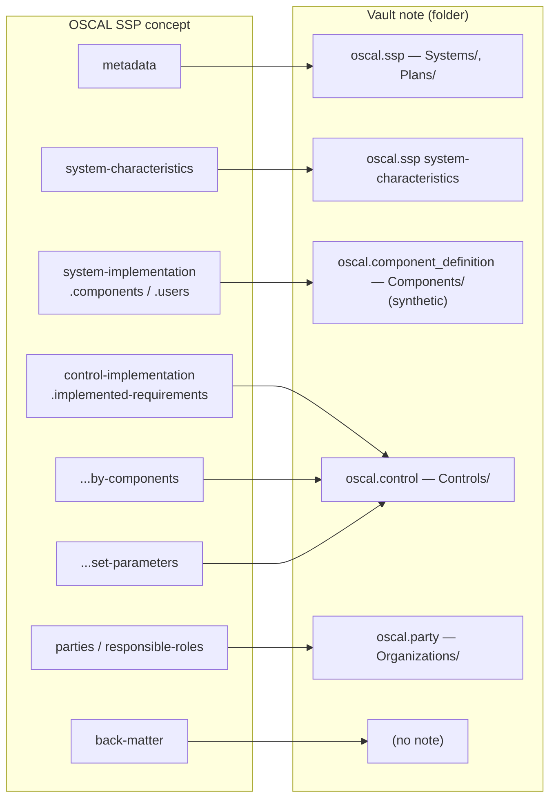

| OSCAL concept | Vault note (folder) | Read code | Export code |
|---|---|---|---|
| metadata (title/version) | `oscal.ssp` fm | `vault.py:1026-1043` | `export_oscal.py:404-409` |
| system-characteristics | `oscal.ssp` → `Systems/` | `vault.py:733-757`, enriched `:1810-1848` | `canonical_to_oscal_ssp:317` |
| implemented-requirements | `oscal.control` → `Controls/` | `vault.py:378-453` | `export_oscal.py:317-473` |
| by-components | (synthetic single component) | — | `export_oscal.py:227-239` |
| set-parameters | control fm `parameters` | `control_parameters.py` → `vault.py:455-459` | `_oscal_set_parameters:203-207` |
| parties / responsible-roles | `oscal.party` → `Organizations/` | `vault.py:909-996` | `metadata.parties[]` + `responsible-parties[]` (D-1 wired) |
| system-implementation.components (real) | synthetic `Components/` | `vault.py:829-873` | `export_oscal.py` this-system component |
| network-architecture / data-flow | `oscal.x.boundary` / `oscal.x.relationship` | `vault.py` narrative notes | `oscal_extension_bridge.py` → native `system-characteristics.*` |
| authorization-boundary.diagrams + back-matter.resources | `oscal.x.diagram` | narrative note | `oscal_extension_bridge.py` (cross-referenced by uuid) |
| component protocols (ports/protocols/services) | `oscal.x.relationship` | narrative note | `oscal_extension_bridge.py` → `components[].protocols[]` |
| leveraged-authorizations | `oscal.x.inheritance` | narrative note | `oscal_extension_bridge.py` → `system-implementation.leveraged-authorizations[]` |
| component control-implementations | `oscal.control` | `vault.py` | `canonical_to_oscal_component_definition` native `control-implementations[]` |

The bridge is property-specific rather than note-wide. It currently consumes
boundary `description` and `types_of_users`, relationship `interconnections`
and `ports_protocols_services`, and inheritance `provided_by`. Other boundary
and inheritance properties and all diagram contract properties are classified
`unimplemented` rather than claiming substituted or dropped values. External
services export as `component-definition.components[].props[]`; capabilities
are generated from component-linked controls, not from `external_services`.
CRM `.ods` data merged into control frontmatter is consumed by SSP
`by-components[].export`; standalone `oscal.x.crm` narrative notes are not.

> **OSBAPI service offering + CRM inheritance (OSCAL core).** An OSBAPI service
> offering is modeled as a `component-definition.capabilities[]` `capability`
> that declares the controls it provides via
> `control-implementations[].implemented-requirements[]`, and the shared-
> responsibility (CRM) statement — what the provider satisfies vs. what the
> consumer must still do to **fully inherit** — is carried in native
> `by-component.export.provided[]` / `.responsibilities[]`. See
> [`osbapi-backstage-interop/capabilities-as-osbapi-offerings.md`](osbapi-backstage-interop/capabilities-as-osbapi-offerings.md).
> This is the project's standing preference: use OSCAL core fields (even
> loosely) over custom `oscal.x.*` extensions for interoperability.

> The **export path deliberately demotes** FedRAMP-specific fields
> (`control-origination`, `implementation-status`) to OSCAL `props[]`
> (`export_oscal.py:106-126,184-201`) per FedRAMP convention, and when a plan
> has no captured controls it emits a documented placeholder `control-id:
> "ac-1"` to satisfy the non-empty-array schema rule (`export_oscal.py:381-399`).

---

## 4. Content lifecycle: transient vs ultimate storage

Content passes through five representations, each with a distinct commit
policy. This is what keeps git history clean while making exports reproducible
(ADR-002 / ADR-012).

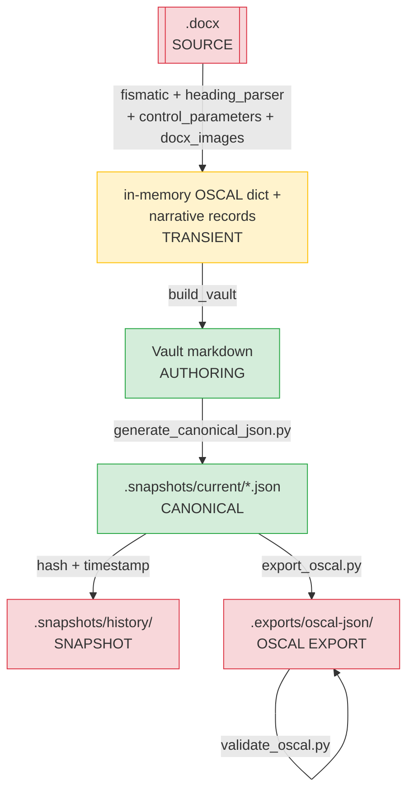

| Layer | Committed? | Evidence |
|---|---|---|
| Source `.docx` | **gitignored** (green) | `.gitignore` `*.docx` (only 4 `.jinja.docx` templates committed) |
| In-memory OSCAL dict | transient | assembled in `export_obsidian_vault.py:300-359` |
| Vault markdown | **committed** | authoring source of truth |
| `.snapshots/current/*.json` | **committed** | canonical, hash-stable |
| `.snapshots/history/` | gitignored | volatile snapshots |
| `.exports/oscal-json/` | gitignored | regenerable from canonical JSON |

### 4.1 Hash-stable canonical JSON

`compliance/lib/canonical_json.py:generate_canonical_data` (`:131-188`) makes
the canonical layer **content-addressable**:

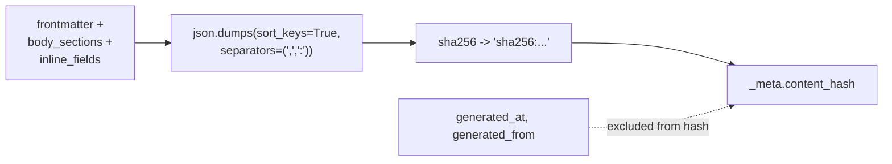

The volatile `_meta` (timestamps) is **excluded** from the hash, so the hash
changes only when actual content changes — regenerating at a different time
produces an identical hash. This is the mechanism that lets CI detect real
content drift while ignoring cosmetic regeneration.

---

## 5. The roundtrip back to `.docx`

A partial reverse path fills a blank FedRAMP template using `docxtpl`, driven
by four roundtrip contracts
(`compliance/datacontracts/{low,moderate,high}-sspp-roundtrip.yaml` and
`leveraged-saas-crm-roundtrip.yaml`).

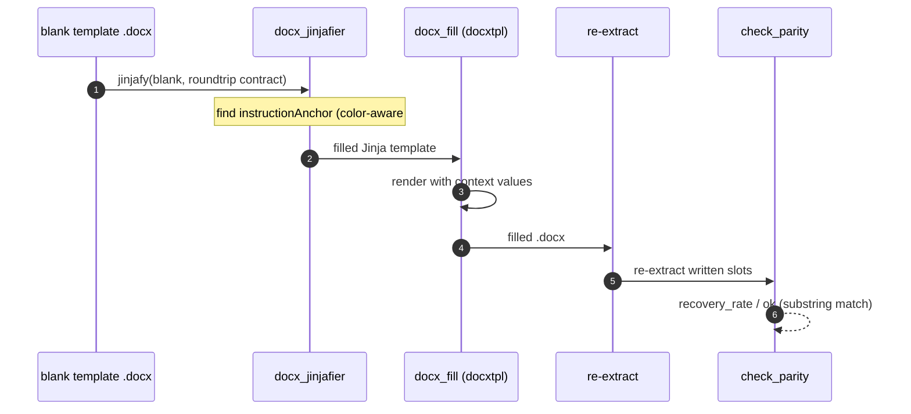

The roundtrip write keys live **only** in these contracts (never in
`fedramp-ssp-v1.yaml`):

| Key | Meaning | Code |
|---|---|---|
| `instructionAnchor` | Text/regex of the instruction block preceding a writable slot; the join key across passes | `instruction_anchors.py` |
| `writeStrategy` | `paragraph_after_instruction` / `table_after_instruction` / `constant` | `docx_jinjafier.py:203-235` |
| `templateTag` | Jinja variable injected into the slot | `docx_jinjafier.py:212` |
| `writeScope` | `replace_slot` (default) / `append` | `docx_jinjafier.py:213-221` |

> The roundtrip currently covers only **4 narrative slots** per SSP (2 for
> CRM) and carries **no `oscalPath`**, so structured/control content and the
> OSCAL binding do not survive the reverse trip. Tracked as
> [D-14](#9-known-lossless-coverage-discrepancies)/[D-15](#9-known-lossless-coverage-discrepancies).

---

## 6. Lossless coverage as a goal

Lossless coverage — *every meaningful value in the source `.docx` survives to
the OSCAL export and back* — is an **explicit, stated goal**, but it is a
*target*, not a *current guarantee*:

- **Field parity target (100%)** — the refactoring plan is not exported to the public core
  (Phase R12): "Target 100% field parity (zero-loss) on all extracted values."
  R12 is **planned, not implemented** (no `r12`-marked tests).
- **Roundtrip parity target (100% of filled slots)** —
  the roundtrip template plan, which is not exported to the public core.
- **Content-ratio is *not* targeted at 100%** —
  `scripts/vault_coverage_analysis.py:18-24` notes the vault legitimately drops
  blank-template instruction boilerplate, "so 100% is not the target."

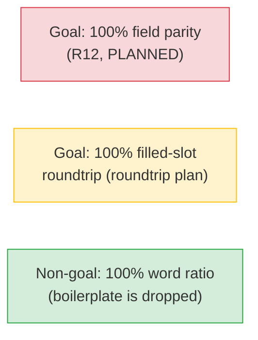

---

## 7. Measuring coverage

Four complementary meters quantify how much is captured. Each has a precise
definition:

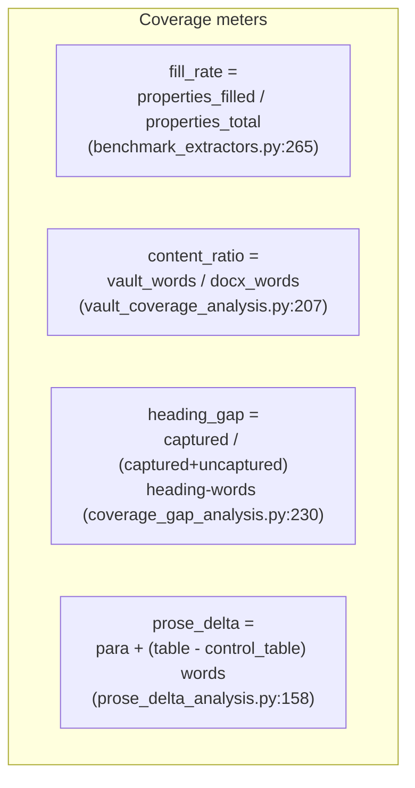

| Meter | Formula | Script | Current |
|---|---|---|---|
| Contract fill rate | `properties_filled / properties_total` | `compliance/scripts/benchmark_extractors.py:265-267` | **66.9% mean** (R14/R15) |
| Content ratio | `vault_words / docx_words` | `scripts/vault_coverage_analysis.py:207` | per-system |
| Heading routing gap | `captured_headingwords / total_headingwords` | `scripts/coverage_gap_analysis.py:230-236` | ranks uncaptured |
| Prose delta | `para + (table − control_table)` words dropped | `scripts/prose_delta_analysis.py:158-160` | Ch 1-12 vs 13 |

**Current headline number: 66.9% mean fill rate**
because R14 added 8 new properties to the denominator
(`R14_EQUAL_FOOTING_REPORT.md:117`) — no document reaches 100% and none reaches
0%. The `properties_total` denominator includes ~18 `value: derived` UUID
properties that can *never* be heading-captured, which structurally understates
coverage; the benchmark therefore now also reports a **`capturable_fill_rate`**
that excludes those derived properties (D-12 / #47, resolved).

**What is measured as NOT captured** (from `scripts/docx_catchall_dump.py` and
the benchmark reports):

- Every non-control **paragraph**, every **non-control table**, and every
  **image** is tagged `DROPPED` by the raw dumper (`docx_catchall_dump.py:301-317`);
  the heading_parser secondary path then recovers a subset.
- Recurring **unrouted headings**: the cover-page H1
  `U.S. General Services Administration` (10/10 SSPs, ~454 ¶, still unrouted per
  `R15:95`), plus 8 `10.x` sub-headings in one SSP (`R15:96`).

---

## 8. Validating faithfulness

Validation includes schema conformance, canonical/OSCAL parity, a CUI-safe
end-to-end field-fidelity fixture, and source-located instruction reconciliation.
The remaining major fidelity gap is a stateful relational-store round trip.

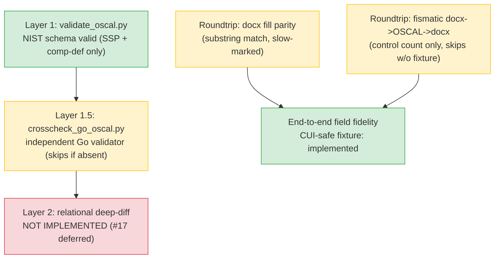

| Mechanism | Proves | Where |
|---|---|---|
| Layer 1 schema | export is NIST-schema-valid | `compliance/lib/validate_oscal.py:41-44` |
| Layer 1.5 go-oscal | independent corroboration (optional) | `compliance/scripts/crosscheck_go_oscal.py:100-107` |
| Layer 2 deep-diff | relational data loss | **not implemented** — ADR-019, `#17` |
| Roundtrip fill parity | written slots recovered | `test_docx_fill_roundtrip.py` (slow) |
| End-to-end field fidelity | source-derived values survive DOCX→vault→OSCAL | `test_end_to_end_fidelity.py` |
| Instruction provenance | source locator/hash reconciles through vault and sidecar | `test_instruction_ledger.py` |
| Export schema-validity | vault→OSCAL passes Layer 1 | `test_validate_oscal.py` |

Remaining roundtrip limitation: table-cell fill is scaffolded but the committed
demo primarily exercises paragraph slots. Strict table-slot parity is tracked
in issue #47.

### OSCAL mapping capabilities and runtime lineage

Mapping capability reports intentionally count `native`, `extension_bridge`, and
`preserved_only` derivations separately. These counters may drift independently:
native coverage increases when a concept gains a schema-backed OSCAL mapping;
extension-bridge coverage changes when authoring extensions are promoted to or
removed from native assemblies; preserved-only coverage changes when content is
retained for fidelity but has no OSCAL semantic destination. CI requires every
active contract mapping to have a capability claim, but does not collapse these
three meanings into one success percentage.

The capability registry declares operators an adapter may execute; it does not
claim they ran. Runtime export lineage contains only emitted execution events.
Lossy operator implementations use digest-bound review attestations, and parser
residuals must be preserved explicitly. The lineage schema, rather than
individual transform names, carries the compatibility version.

Artifacts are deliberately separated:

- `_exports/oscal-mapping-capabilities.json` describes mappings and allowed
  operators; it is design-time metadata.
- `.exports/lineage/*-lineage.json` contains concrete source/canonical/OSCAL
  pointers and only the operators executed during that export.
- `compliance/data/lineage_operator_attestations_v1.json` binds review decisions
  to the current transform and bridge implementation digest. Code changes make
  attestations stale and fail CI until reviewed and updated.

Runtime parsers account for residual content. Parsed native values, preserved
residual extensions, and explicit exclusions must cover the complete input; a
residual without a preservation record fails runtime lineage validation.

---

## 9. Known lossless-coverage discrepancies

The following were concrete, evidenced gaps between the stated lossless goal and
the implementation. Each was filed as a GitHub issue (labeled
`lossless-coverage`) and grouped by where the loss occurred. Issue
#49 (upstream parser) is the
umbrella that tracks the full set plus the pre-existing related issues (#17,
#24, #26, #27, #28).

> **Status (2026-07-22):** D-1, D-3, D-4, D-5, D-6, D-7, D-8, D-9, D-11, D-12,
> D-13, D-16, D-17 and the end-to-end fidelity test (D-18) are **resolved** on
> `phase-29-lossless-coverage`. The exporter now emits parties /
> responsible-parties / responsible-roles, statement prose flows to the
> by-component description, privacy/evidence/cloud-model/inventory/references/
> glossary content reaches the vault, contract and vault folder casing agree
> (guarded by a test), `handledByPrimaryParser` is honored, the benchmark
> reports a `capturable_fill_rate`, the empty-SSP placeholder is marked
> `synthetic`, and `test_end_to_end_fidelity.py` threads real fields through
> `.docx → vault → OSCAL`. Remaining/deferred: **D-2** (exporter still uses a
> hardcoded structure — now *guarded* by `test_contract_export_consistency.py`
> so a declared `oscalPath` cannot name a non-exportable model, full path-driven
> export tracked in #39), **D-10** (extra OSCAL models — #27), and **D-14/D-15**
> (roundtrip breadth / OSCAL binding — #48).

### 9.1 Contract objects captured but dropped from the vault

| ID | Discrepancy | Evidence |
|---|---|---|
| **D-3** (#40 (upstream parser)) | `oscal_x_privacy` and `oscal_x_evidence` declare real capture strategies but have **no consumer** in `vault.py` — extracted PII and attachment content is discarded | contract `:1793-1974`; `grep -c oscal_x_privacy\|oscal_x_evidence vault.py` → 0 |
| **D-4** (#41 (upstream parser)) | `cloud_service_model` / `cloud_deployment_model` are extracted (R14) but never surfaced in the system note | contract `:713-750`; `vault.py` only a placeholder `:875` |
| **D-5** (#41 (upstream parser)) | `oscal_component_definition` inventory props (inventory_items, software_inventory, external_services, aws_services_in_use) are extracted but the synthetic Components note references none | contract `:1290-1349`; `vault.py:829-873` |
| **D-6** (#41 (upstream parser)) | `okf_mapping` (references, laws) and `okf_schema_glossary` (terms) extractions are unused — vault emits hardcoded vocab tables | contract `:2078-2137`; `vault.py:1275,2032` |

### 9.2 Vault → OSCAL export losses

| ID | Discrepancy | Evidence |
|---|---|---|
| **D-1** (#38 (upstream parser)) | Parties/roles never reach the exported SSP — `get_exportable_types()` omits `oscal.party` and the metadata block emits no `parties`/`responsible-parties` | `export_oscal.py:583-591`; `grep responsible-parties` → 0 |
| **D-2** (#39 (upstream parser)) | `oscalPath` is documentation-only; export structure is a parallel hardcoded implementation that can silently diverge from the contract | `grep -c oscal_path export_oscal.py` → 0 |
| **D-7** (#42 (upstream parser)) | Control statement prose maps to `statements[].remarks` on export but `statements[].description` via fismatic — asymmetric roundtrip | `export_oscal.py:211-225` vs `vault.py:414`/`oscal_source.py:44-48` |
| **D-10** (#27 (upstream parser)) | `poam`/`assessment_plan`/`assessment_results`/`profile`/`catalog` are listed exportable but have no converter | `export_oscal.py:583-591`; only 2 `canonical_to_oscal_*` functions |
| **D-11** (#46 (upstream parser)) | Empty-SSP export fabricates a placeholder `control-id: "ac-1"` a consumer could mistake for real | `export_oscal.py:381-399` |

### 9.3 Contract / vault structural mismatches

| ID | Discrepancy | Evidence |
|---|---|---|
| **D-9** (#43 (upstream parser)) | `handledByPrimaryParser: true` makes `oscal_control` contract props (`parameters`, `related_controls`, `customer_responsibilities`) dead; the flag is never read by heading_parser | contract `:2164,2489-2590`; `grep handledByPrimaryParser compliance/lib` |
| **D-13** (#44 (upstream parser)) | 13 `heading_paragraph` props lack `captureScope`, defaulting to `immediate_only`, dropping sub-heading prose | `heading_parser.py:903` |
| **D-17** (#45 (upstream parser)) | Contract `destinationFolder` uses lowercase (`boundaries/`, `diagrams/`, `evidence/`, `Privacy/`) but the vault emits Capitalized folders (`Boundaries/`, `Diagrams/`) and has no `evidence/`/`Privacy/` folder — declared vs emitted path divergence | contract folders vs `examples/vault/<system>/` |

### 9.4 Roundtrip and measurement gaps

| ID | Discrepancy | Evidence |
|---|---|---|
| **D-8** (#42 (upstream parser)) | `control-origination` / `implementation-status` demoted to `props[]` rather than first-class OSCAL fields (intentional, but non-standard) | `export_oscal.py:106-126,184-201` |
| **D-12** (#47 (upstream parser)) | Fill-rate denominator includes ~18 un-capturable `derived`/UUID properties, understating coverage | `benchmark_extractors.py:265-267` |
| **D-14** (#48 (upstream parser)) | Roundtrip fill covers only 4 narrative slots (2 for CRM); no control/table/party write-back | `*-sspp-roundtrip.yaml` |
| **D-15** (#48 (upstream parser)) | Roundtrip contracts declare no `oscalPath` — fill-back has no OSCAL binding | `grep oscalPath *-sspp-roundtrip.yaml` → 0 |
| **D-16** (#48 (upstream parser)) | Roundtrip contracts are near-identical clones; a `general_system_description` slot reads `sourceHeading: "Asset Inventory"` | `low-sspp-roundtrip.yaml:148-165` |
| **D-18** (#49 (upstream parser)) | No Layer-2 semantic validation of vault→OSCAL faithfulness; combined with D-2 there is no automated lossless guarantee | ADR-019; `#17` deferred |

### 9.5 The loss map

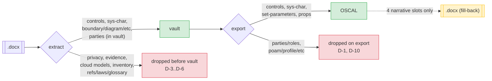

> **Toward lossless.** Closing the loop requires: (1) wiring the four dropped
> contract objects into `vault.py` (D-3–D-6); (2) exporting parties/roles and
> making the exporter read `oscalPath` (D-1, D-2); and (3) adding a Layer-2
> field-fidelity test that threads a real value through `.docx → vault → OSCAL`
> (D-18). Until then, the 66.9% fill rate and schema-valid exports are the
> honest ceiling of what is currently guaranteed.
