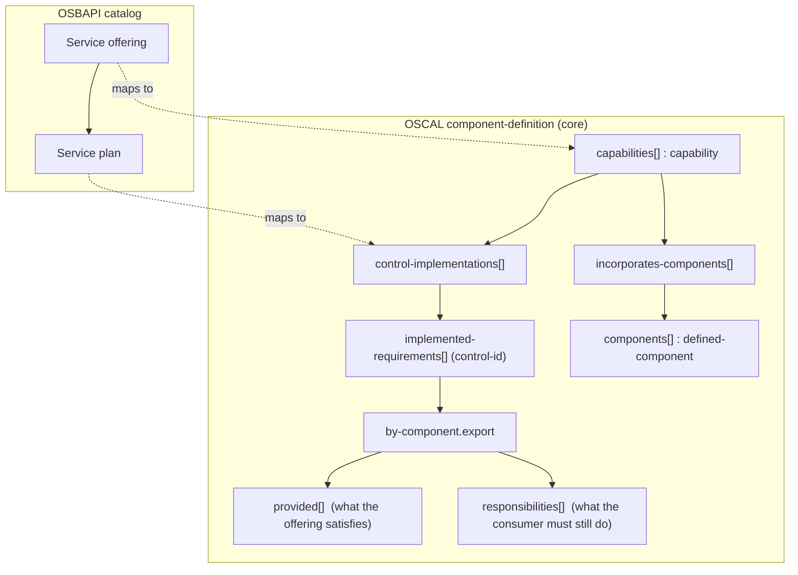
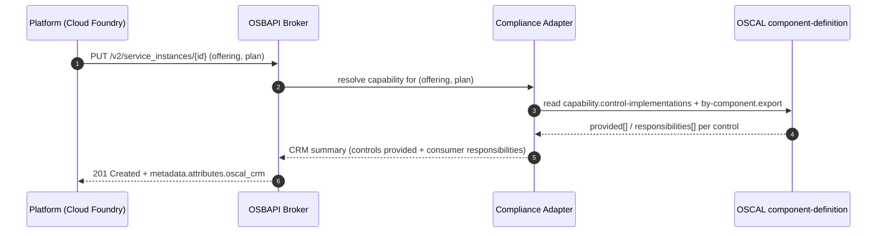

# Capabilities as OSBAPI Service Offerings: declaring & inheriting controls

status: canonical
tier: 1
last_updated: "2026-10-08"
related:
  - compliance/schemas/oscal-1.1.3/oscal_component_schema.json
  - compliance/schemas/oscal-1.1.3/oscal_ssp_schema.json
  - compliance/lib/export_oscal.py
  - compliance/lib/oscal_extension_bridge.py
  - docs/osbapi-backstage-interop/oscal-to-osbapi-projection.yaml

---

## Purpose

This document specifies how an [Open Service Broker API](https://www.openservicebrokerapi.org/)
(OSBAPI) **service offering** is modeled in OSCAL **core** so that a component can:

1. **declare the controls it can implement or otherwise provide** to the systems
   that consume it, and
2. carry a **CRM-style inheritance statement** — "if you leverage me, here is
   what *I* satisfy and what *you* must still do to fully inherit."

The guiding decision (see the metrics-drift / extension-bridge work): **prefer
OSCAL core fields over custom `oscal.x.*` extensions for interoperability, even
if a field is used somewhat loosely.** Everything below maps onto native OSCAL
assemblies; no new custom namespace is introduced.

---

## 1. OSBAPI object model → OSCAL core

An OSBAPI catalog has a stable shape: a **service offering** contains one or
more **service plans**, and a provisioned **service instance** is one plan in
use. OSCAL's `component-definition` models exactly this shape with native
fields:

| OSBAPI concept | OSCAL core assembly | Why it fits |
|---|---|---|
| Service **offering** | `component-definition.capabilities[]` (`capability`) | A capability is a named, described grouping that declares what it provides and incorporates other components. The offering is the unit a consumer "turns on." |
| Service **plan** / tier | `capability.incorporates-components[]` + per-plan `capability.control-implementations[]` | Each plan incorporates the concrete `defined-component`(s) and declares the controls that plan satisfies. |
| Underlying resource(s) | `component-definition.components[]` (`defined-component`) | The IaaS/PaaS/SaaS building blocks a capability composes. |
| "This offering **provides** these controls" | `capability.control-implementations[].implemented-requirements[]` (`control-id`) | The native list of control-ids the capability implements. |
| "To fully inherit, the **customer must** …" | **consuming SSP** `by-component.export` → `provided[]` / `responsibilities[]` | The native CRM split. See §3 for *where* this field actually lives. |

> **Schema reality (verified against the vendored 1.1.3 schemas).** In OSCAL
> 1.1.3 the `export` / `provided` / `responsibilities` CRM assembly is a field of
> **`by-component` in the `system-security-plan` model only**. The
> `component-definition` model's `implemented-requirement` carries
> `statements`, `set-parameters`, and `responsible-roles` but **not** a
> `by-component.export`. Therefore:
>
> - A **capability declares** the controls it provides (the `control-id` list
>   in `control-implementations`), plus human CRM text in each requirement's
>   `description` / `statements[].description` / `responsible-roles`.
> - The **machine-readable "provided vs. consumer-responsibility" split** is
>   authored on the **consuming system's SSP** `by-component.export`, which
>   points back at the leveraged component. This is the OSCAL-core design: the
>   provider publishes capabilities; the consumer's SSP records what it inherits
>   and what residual responsibility it accepts.



---

## 2. Declaring the controls a capability provides

`capability` is a first-class member of `component-definition` with required
`uuid`, `name`, `description`, plus `incorporates-components[]` and
`control-implementations[]` (verified against
`compliance/schemas/oscal-1.1.3/oscal_component_schema.json`).

```jsonc
{
  "component-definition": {
    "uuid": "…",
    "metadata": { "title": "Example Platform Pages — service offering", "version": "1.0", "oscal-version": "1.1.3" },
    "components": [
      { "uuid": "comp-pages", "type": "service", "title": "Example Platform Pages", "description": "…" }
    ],
    "capabilities": [
      {
        "uuid": "cap-pages-managed",
        "name": "Managed static hosting (plan: managed)",
        "description": "Fully managed static site hosting. Consumers inherit the controls listed below.",
        "incorporates-components": [
          { "component-uuid": "comp-pages", "description": "Backed by the Example Platform Pages component." }
        ],
        "control-implementations": [
          {
            "uuid": "ci-pages-managed",
            "source": "#fedramp-rev5-moderate-profile",
            "description": "Controls this offering implements or provides for inheritance.",
            "implemented-requirements": [
              {
                "uuid": "ir-ac-2",
                "control-id": "ac-2",
                "description": "Account management is performed by the platform for the hosting plane. Consumer must manage application-level accounts (see statements).",
                "statements": [
                  {
                    "statement-id": "ac-2_smt.a",
                    "uuid": "st-ac-2-a",
                    "description": "Provider satisfies hosting-plane account types; consumer defines application account types.",
                    "responsible-roles": [ { "role-id": "platform-provider" } ]
                  }
                ]
              }
            ]
          }
        ]
      }
    ]
  }
}
```

The list of `control-id`s under `implemented-requirements[]` **is** the
machine-readable answer to "what controls can this offering implement or
provide." A consumer SSP that leverages this offering reads that list to decide
which controls it may mark `inherited`.

---

## 3. The CRM-style inheritance statement (`by-component.export`)

OSCAL models the "shared responsibility" split natively on
`by-component.export`, with two arrays (verified against `oscal_ssp_schema.json`).
**This assembly lives on the consuming system's SSP**, where a `by-component`
references the leveraged capability/component by `component-uuid`:

- **`provided[]`** — *what the offering satisfies on the consumer's behalf.*
  Each has `uuid`, `description`, optional `responsible-roles`.
- **`responsibilities[]`** — *what the consumer must still do to fully inherit.*
  Each has `uuid`, `description`, and `provided-uuid` linking it to the
  `provided` statement it qualifies.

```jsonc
// In the CONSUMER system's SSP: control-implementation →
// implemented-requirement (ac-2) → by-components[]:
"by-components": [
  {
    "component-uuid": "comp-pages",   // the leveraged offering/component
    "uuid": "bc-ac-2",
    "description": "AC-2 inherited from the Example Platform Pages managed offering.",
    "export": {
      "description": "Shared-responsibility (CRM) statement for AC-2 under this offering.",
      "provided": [
        {
          "uuid": "prov-ac-2",
          "description": "The platform creates, disables, and audits hosting-plane service accounts; AC-2(a)(d)(f)(g) are satisfied for the hosting plane.",
          "responsible-roles": [ { "role-id": "platform-provider" } ]
        }
      ],
      "responsibilities": [
        {
          "uuid": "resp-ac-2",
          "provided-uuid": "prov-ac-2",
          "description": "To fully inherit AC-2 the consumer MUST: (1) manage application-level accounts within their deployed site, (2) define account types in their own SSP, and (3) review their application accounts at least annually.",
          "responsible-roles": [ { "role-id": "consumer-system-owner" } ]
        }
      ]
    },
    "inherited": [
      { "uuid": "inh-ac-2", "provided-uuid": "prov-ac-2", "description": "Consumer accepts the provided AC-2 account management." }
    ],
    "satisfied": [
      { "uuid": "sat-ac-2", "responsibility-uuid": "resp-ac-2", "description": "Consumer manages application accounts via its deploy pipeline." }
    ]
  }
]
```

Read as a CRM row: `provided` = "done for you," `responsibilities` = "you must
do." The `provided-uuid` / `responsibility-uuid` back-references are what let
the consumer SSP's `inherited[]` / `satisfied[]` point back at the exact
provider statement, closing the inheritance loop in OSCAL core without any
extension.

| CRM column (human) | OSCAL core field |
|---|---|
| Control | `implemented-requirement.control-id` |
| Provider does | `by-component.export.provided[].description` |
| Customer must do (to fully inherit) | `by-component.export.responsibilities[].description` |
| Link between the two | `responsibilities[].provided-uuid → provided[].uuid` |
| Who (provider / consumer) | `*.responsible-roles[].role-id` |
| Consumer accepts inheritance | consumer SSP `by-component.inherited[].provided-uuid` |
| Consumer-side residual satisfied | consumer SSP `by-component.satisfied[].responsibility-uuid` |

This replaces the former `oscal.x.crm` / `oscal.x.inheritance` custom notes as
the **export representation**: the vault may still author inheritance in those
notes, but the exporter projects them into `export.provided` /
`export.responsibilities` so downstream OSCAL consumers get standard fields.

---

## 4. OSBAPI runtime projection

When a broker provisions a plan, the adapter reads the capability's
`control-implementations` and emits the CRM summary from `export`:



- offering ↔ `capability`
- plan ↔ a `control-implementations[]` entry (or a capability per plan)
- the `201` CRM payload is `provided` (inheritable) + `responsibilities`
  (consumer to-do), both drawn from OSCAL core.

---

## 5. Status & implementation seam

- **Schema**: all fields above are native OSCAL 1.1.3 (`capability`,
  `incorporates-components`, `control-implementations`, `by-component.export`,
  `provided`, `responsibilities`) — confirmed present in the vendored schemas.
- **Exporter**: `canonical_to_oscal_component_definition` now derives a native
  `capabilities[]` entry from the existing control → component graph (no
  duplicate `implements_controls` index) and emits the component's
  `control-implementations[]`. The SSP exporter now projects actual control
  `crm`, `inherited_from`, and `customer_responsibilities` fields into native
  `by-component.export.provided[]` / `.responsibilities[]`. It emits no CRM
  split when the vault has no provider/responsibility facts, rather than
  fabricating them.
- **Projection**: the OSBAPI/Backstage transform in
  `docs/osbapi-backstage-interop/oscal-to-osbapi-projection.yaml` consumes these
  native fields; it must not depend on `oscal.x.*` custom notes.
