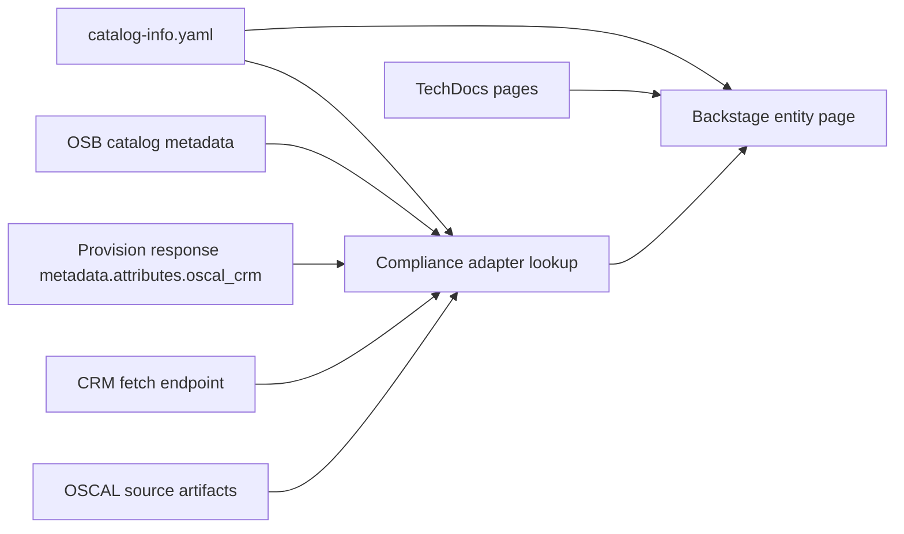

# Detailed Examples — OSBAPI ↔ OSCAL ↔ Backstage

This document provides concrete examples for each major component and system in the architecture: Backstage entities, OSB catalog metadata, provision responses, CRM fetch responses, OSCAL-aligned projections, and adapter API payloads.

## 1. Backstage catalog entities

Backstage catalog entities use `apiVersion`, `kind`, `metadata`, and `spec`, with annotations as the normal extension mechanism for custom metadata [web:72][web:67].

### 1.1 System entity

```yaml
apiVersion: backstage.io/v1alpha1
kind: System
metadata:
  name: cloud-foundry-platform
  title: Cloud Foundry Platform
  description: Platform system representing the brokered Cloud Foundry environment and its compliance overlays.
  annotations:
    backstage.io/techdocs-ref: dir:./docs/platform
    oscal.io/profile-ref: https://oscal-project.github.io/osbapi-crm-profile/v1
  tags:
    - cloud-foundry
    - compliance
    - oscal
spec:
  owner: group:platform-engineering
  domain: platform
```

### 1.2 Broker component entity

```yaml
apiVersion: backstage.io/v1alpha1
kind: Component
metadata:
  name: csb-broker
  title: Cloud Service Broker
  description: OSBAPI broker used to provision managed services for Cloud Foundry apps.
  annotations:
    github.com/project-slug: example-org/cloud-service-broker
    backstage.io/techdocs-ref: dir:./docs/broker
    oscal.io/component-ref: urn:uuid:7d6f1c4b-broker-component
    oscal.io/ssp-ref: https://compliance.example.gov/oscal/ssp/cloud-platform.json
    oscal.io/crm-endpoint: https://compliance.example.gov/api/compliance/entities/component:default/csb-broker
    oscal.io/evidence-endpoint: https://compliance.example.gov/api/evidence/component:default/csb-broker
    oscal.io/implementation-status: operational
  tags:
    - broker
    - osbapi
    - cloud-foundry
spec:
  type: service
  lifecycle: production
  owner: group:platform-engineering
  system: cloud-foundry-platform
  providesApis:
    - osbapi-broker-api
```

### 1.3 Service offering resource entity

```yaml
apiVersion: backstage.io/v1alpha1
kind: Resource
metadata:
  name: aws-rds-postgres-offering
  title: AWS RDS PostgreSQL Offering
  description: Brokered PostgreSQL offering exposed through the Cloud Service Broker.
  annotations:
    backstage.io/techdocs-ref: dir:./docs/services/aws-rds-postgres
    oscal.io/component-ref: urn:uuid:49f2f2aa-rds-component
    oscal.io/crm-endpoint: https://compliance.example.gov/api/compliance/entities/resource:default/aws-rds-postgres-offering
    oscal.io/implementation-status: operational
  tags:
    - postgres
    - aws
    - brokered-service
spec:
  type: service-instance-class
  owner: group:platform-engineering
  system: cloud-foundry-platform
```

### 1.4 Cloud Foundry app component entity

```yaml
apiVersion: backstage.io/v1alpha1
kind: Component
metadata:
  name: customer-portal
  title: Customer Portal
  description: Cloud Foundry application that consumes brokered database and redis services.
  annotations:
    backstage.io/techdocs-ref: dir:./docs/apps/customer-portal
    oscal.io/crm-endpoint: https://compliance.example.gov/api/compliance/entities/component:default/customer-portal
  tags:
    - app
    - cloud-foundry
spec:
  type: service
  lifecycle: production
  owner: group:app-team
  system: cloud-foundry-platform
  dependsOn:
    - resource:default/aws-rds-postgres-offering
    - resource:default/aws-elasticache-redis-offering
```

### 1.5 API entity for adapter service

```yaml
apiVersion: backstage.io/v1alpha1
kind: API
metadata:
  name: compliance-adapter-api
  description: API that projects broker and OSCAL compliance state into Backstage-ready payloads.
spec:
  type: openapi
  lifecycle: production
  owner: group:platform-engineering
  system: cloud-foundry-platform
  definition:
    $text: https://compliance.example.gov/openapi.json
```

## 2. Broker catalog example

OSBAPI profiles are the established mechanism for extending the base broker contract in specific environments [web:95].

### 2.1 Catalog service with compliance metadata

```json
{
  "services": [
    {
      "name": "aws-rds-postgres",
      "id": "9c6f6db7-0a2d-4f13-a3ef-rds-postgres",
      "description": "Provision Amazon RDS PostgreSQL for Cloud Foundry applications.",
      "bindable": true,
      "instances_retrievable": true,
      "bindings_retrievable": true,
      "metadata": {
        "displayName": "AWS RDS PostgreSQL",
        "documentationUrl": "https://docs.example.gov/services/aws-rds-postgres",
        "supportUrl": "https://support.example.gov/platform",
        "compliance_support": {
          "profile": "https://oscal-project.github.io/osbapi-crm-profile/v1",
          "component_definition_uri": "https://compliance.example.gov/oscal/components/aws-rds-postgres-component.json",
          "ssp_uri": "https://compliance.example.gov/oscal/ssp/cloud-platform.json",
          "crm_summary_on_provision": true,
          "crm_fetch_supported": true,
          "frameworks": ["FedRAMP-High", "NIST-800-53r5"],
          "control_families": ["AC", "AU", "CM", "SC"]
        }
      },
      "plans": [
        {
          "id": "dc59dba3-7a3c-44d5-a850-small-plan",
          "name": "small",
          "description": "Small PostgreSQL plan for development and low-volume workloads.",
          "metadata": {
            "bullets": ["Single AZ", "Encrypted at rest", "Broker-managed credentials"],
            "compliance_tier": "platform-inherited-plus-customer-config"
          },
          "schemas": {
            "service_instance": {
              "create": {
                "parameters": {
                  "$schema": "http://json-schema.org/draft-07/schema#",
                  "type": "object",
                  "properties": {
                    "storage_gb": { "type": "integer", "minimum": 20, "maximum": 200 },
                    "backup_retention_days": { "type": "integer", "minimum": 1, "maximum": 35 },
                    "customer_managed_key": { "type": "boolean" }
                  }
                }
              }
            }
          }
        }
      ]
    }
  ]
}
```

## 3. Provision flow examples

### 3.1 Provision request

```json
{
  "service_id": "9c6f6db7-0a2d-4f13-a3ef-rds-postgres",
  "plan_id": "dc59dba3-7a3c-44d5-a850-small-plan",
  "organization_guid": "org-001",
  "space_guid": "space-abc",
  "context": {
    "platform": "cloudfoundry",
    "instance_name": "customer-portal-db"
  },
  "parameters": {
    "storage_gb": 50,
    "backup_retention_days": 7,
    "customer_managed_key": false
  }
}
```

### 3.2 Provision response with CRM summary in `metadata.attributes.oscal_crm`

```json
{
  "dashboard_url": "https://broker.example.gov/instances/instance-123",
  "metadata": {
    "attributes": {
      "oscal_crm": {
        "profile": "https://oscal-project.github.io/osbapi-crm-profile/v1",
        "version": "1.0.0",
        "service_offering_id": "9c6f6db7-0a2d-4f13-a3ef-rds-postgres",
        "plan_id": "dc59dba3-7a3c-44d5-a850-small-plan",
        "component_ref": "urn:uuid:49f2f2aa-rds-component",
        "ssp_ref": "https://compliance.example.gov/oscal/ssp/cloud-platform.json",
        "crm_document_uri": "https://broker.example.gov/v2/service_instances/instance-123/compliance/crm",
        "last_assessed_at": "2026-06-15T18:22:11Z",
        "controls": [
          {
            "control_id": "AC-2",
            "statement_ids": ["ac-2_smt.a"],
            "origination": "shared",
            "implementation_model": "paas",
            "implementation_status": "operational",
            "exportable": true,
            "responsible_role": "platform-iam",
            "remarks": "Account lifecycle and provisioning workflow inherited from platform identity controls."
          },
          {
            "control_id": "SC-13",
            "origination": "system-specific",
            "implementation_model": "paas",
            "implementation_status": "operational",
            "exportable": true,
            "responsible_role": "broker-crypto",
            "remarks": "Encryption at rest and in transit enforced by service configuration baseline."
          },
          {
            "control_id": "CM-2",
            "origination": "customer-configured",
            "implementation_model": "customer",
            "implementation_status": "planned",
            "exportable": false,
            "responsible_role": "app-team",
            "remarks": "Customer must define instance-specific configuration standard and retention choices."
          }
        ]
      }
    }
  }
}
```

## 4. Fetch endpoint examples

### 4.1 Broker-side CRM endpoint

```http
GET /v2/service_instances/instance-123/compliance/crm HTTP/1.1
X-Broker-API-Version: 2.17
Authorization: bearer <token>
```

### 4.2 Full CRM response

```json
{
  "profile": "https://oscal-project.github.io/osbapi-crm-profile/v1",
  "generated_at": "2026-07-02T00:05:11Z",
  "service_instance_id": "instance-123",
  "service_offering_id": "9c6f6db7-0a2d-4f13-a3ef-rds-postgres",
  "plan_id": "dc59dba3-7a3c-44d5-a850-small-plan",
  "component_definition_uri": "https://compliance.example.gov/oscal/components/aws-rds-postgres-component.json",
  "ssp_uri": "https://compliance.example.gov/oscal/ssp/cloud-platform.json",
  "leveraged_authorizations": [
    {
      "id": "fedramp-high-platform-au-001",
      "party_uuid": "party-platform-authorizing-official",
      "title": "FedRAMP High Platform Authorization",
      "href": "https://compliance.example.gov/packages/fedramp-high/platform-package.json"
    }
  ],
  "implemented_requirements": [
    {
      "control_id": "AC-2",
      "description": "Account management is enforced through platform identity integration and broker-backed provisioning safeguards.",
      "by_components": [
        {
          "component_uuid": "7d6f1c4b-broker-component",
          "implementation_status": "operational",
          "origination": "shared",
          "exportable": true,
          "inherited_from": ["urn:uuid:base-platform-iam"],
          "satisfied_by": ["procedure-ac2-01"],
          "assessment_procedures": [
            {
              "id": "procedure-ac2-01",
              "method": "automated",
              "description": "Validate org/space-to-identity-group mappings and account deprovisioning workflow through integration tests.",
              "evidence_uri": "https://evidence.example.gov/ac2/account-lifecycle-report.json"
            }
          ],
          "remarks": "Broker enforces service provisioning only for authorized org/space callers."
        }
      ]
    },
    {
      "control_id": "SC-13",
      "description": "Cryptographic protections are enforced by service templates and service binding transport policies.",
      "by_components": [
        {
          "component_uuid": "49f2f2aa-rds-component",
          "implementation_status": "operational",
          "origination": "system-specific",
          "exportable": true,
          "inherited_from": ["urn:uuid:aws-kms-service"],
          "satisfied_by": ["procedure-sc13-01", "procedure-sc13-02"],
          "assessment_procedures": [
            {
              "id": "procedure-sc13-01",
              "method": "examine",
              "description": "Review Terraform plan, brokerpak defaults, and service instance properties for encryption enforcement."
            },
            {
              "id": "procedure-sc13-02",
              "method": "test",
              "description": "Exercise broker provisioning and validate resulting instance encryption attributes through cloud API checks.",
              "evidence_uri": "https://evidence.example.gov/sc13/encryption-validation.json"
            }
          ],
          "remarks": "TLS required for client connections; storage encryption enabled by baseline."
        }
      ]
    }
  ]
}
```

## 5. OSCAL-aligned source examples

The examples below are not complete OSCAL model files; they are focused excerpts showing how the CRM projection maps back to OSCAL implementation-layer structures and leveraged authorization concepts [web:109][web:110].

### 5.1 Component definition excerpt

```json
{
  "component-definition": {
    "uuid": "49f2f2aa-rds-component",
    "metadata": {
      "title": "AWS RDS PostgreSQL Brokered Service Component"
    },
    "components": [
      {
        "uuid": "49f2f2aa-rds-component",
        "type": "service",
        "title": "Brokered AWS RDS PostgreSQL",
        "description": "Managed PostgreSQL service provisioned through an OSBAPI broker for Cloud Foundry applications.",
        "control-implementations": [
          {
            "source": "https://raw.githubusercontent.com/usnistgov/oscal-content/main/nist.gov/SP800-53/rev5/json/NIST_SP-800-53_rev5_catalog.json",
            "implemented-requirements": [
              {
                "control-id": "SC-13",
                "description": "Cryptographic protections are configured through service defaults.",
                "props": [
                  { "name": "implementation-status", "value": "operational" },
                  { "name": "control-origination", "value": "system-specific" },
                  { "name": "exportable", "value": "true" }
                ]
              }
            ]
          }
        ]
      }
    ]
  }
}
```

### 5.2 SSP excerpt with by-component projection target

```json
{
  "system-security-plan": {
    "uuid": "ssp-cloud-platform-001",
    "metadata": {
      "title": "Cloud Platform SSP"
    },
    "control-implementation": {
      "implemented-requirements": [
        {
          "control-id": "SC-13",
          "description": "Platform and brokered services enforce cryptographic protections.",
          "by-components": [
            {
              "component-uuid": "49f2f2aa-rds-component",
              "description": "Encryption at rest and TLS in transit are enabled by default.",
              "props": [
                { "name": "implementation-status", "value": "operational" },
                { "name": "control-origination", "value": "system-specific" },
                { "name": "exportable", "value": "true" }
              ],
              "statements": [
                {
                  "statement-id": "sc-13_smt",
                  "description": "Broker templates and cloud provider defaults enforce storage and transport encryption."
                }
              ]
            }
          ]
        }
      ]
    }
  }
}
```

## 6. Compliance adapter examples

### 6.1 Backstage plugin request

```http
GET /api/compliance/entities/resource:default/aws-rds-postgres-offering HTTP/1.1
Authorization: bearer <backstage-token>
```

### 6.2 Adapter response for entity page

```json
{
  "entity_ref": "resource:default/aws-rds-postgres-offering",
  "broker": {
    "service_offering_id": "9c6f6db7-0a2d-4f13-a3ef-rds-postgres",
    "plan_id": "dc59dba3-7a3c-44d5-a850-small-plan",
    "service_instance_id": "instance-123",
    "broker_name": "csb-broker"
  },
  "oscal": {
    "component_ref": "urn:uuid:49f2f2aa-rds-component",
    "ssp_ref": "https://compliance.example.gov/oscal/ssp/cloud-platform.json",
    "crm_document_uri": "https://broker.example.gov/v2/service_instances/instance-123/compliance/crm"
  },
  "summary": {
    "profile": "https://oscal-project.github.io/osbapi-crm-profile/v1",
    "version": "1.0.0",
    "service_offering_id": "9c6f6db7-0a2d-4f13-a3ef-rds-postgres",
    "plan_id": "dc59dba3-7a3c-44d5-a850-small-plan",
    "component_ref": "urn:uuid:49f2f2aa-rds-component",
    "ssp_ref": "https://compliance.example.gov/oscal/ssp/cloud-platform.json",
    "crm_document_uri": "https://broker.example.gov/v2/service_instances/instance-123/compliance/crm",
    "last_assessed_at": "2026-06-15T18:22:11Z",
    "controls": [
      {
        "control_id": "AC-2",
        "origination": "shared",
        "implementation_model": "paas",
        "implementation_status": "operational",
        "exportable": true,
        "responsible_role": "platform-iam"
      },
      {
        "control_id": "SC-13",
        "origination": "system-specific",
        "implementation_model": "paas",
        "implementation_status": "operational",
        "exportable": true,
        "responsible_role": "broker-crypto"
      },
      {
        "control_id": "CM-2",
        "origination": "customer-configured",
        "implementation_model": "customer",
        "implementation_status": "planned",
        "exportable": false,
        "responsible_role": "app-team"
      }
    ]
  },
  "implemented_requirements": [
    {
      "control_id": "SC-13",
      "description": "Cryptographic protections are enforced by service templates and service binding transport policies.",
      "by_components": [
        {
          "component_uuid": "49f2f2aa-rds-component",
          "implementation_status": "operational",
          "origination": "system-specific",
          "exportable": true,
          "assessment_procedures": [
            {
              "id": "procedure-sc13-02",
              "method": "test",
              "description": "Exercise broker provisioning and validate resulting instance encryption attributes through cloud API checks.",
              "evidence_uri": "https://evidence.example.gov/sc13/encryption-validation.json"
            }
          ],
          "remarks": "TLS required for client connections; storage encryption enabled by baseline."
        }
      ]
    }
  ],
  "techdocs_links": [
    {
      "title": "Service hardening guide",
      "path": "/docs/default/resource/aws-rds-postgres-offering/hardening"
    },
    {
      "title": "Assessment procedures",
      "path": "/docs/default/resource/aws-rds-postgres-offering/assessment-procedures"
    }
  ]
}
```

## 7. TechDocs examples

TechDocs is the right place for the rich human-readable content that should not be embedded directly in entity YAML, including procedures, inheritance narratives, and evidence guidance [web:67][web:72].

### 7.1 `mkdocs.yml`

```yaml
site_name: AWS RDS PostgreSQL Offering
nav:
  - Overview: index.md
  - Hardening: hardening.md
  - Assessment Procedures: assessment-procedures.md
  - Inheritance Map: inheritance-map.md
```

### 7.2 `assessment-procedures.md`

```md
# Assessment Procedures

## SC-13

### Objective
Verify that the brokered PostgreSQL instance enforces encryption at rest and TLS in transit.

### Automated checks
1. Provision a test instance through the broker.
2. Query cloud provider instance attributes.
3. Assert storage encryption is enabled.
4. Assert TLS-required parameter group is attached.

### Evidence
- `sc13/encryption-validation.json`
- `sc13/provisioning-trace.log`

## AC-2

### Objective
Verify only authorized org and space operators can provision and bind the service instance.
```

## 8. End-to-end map


