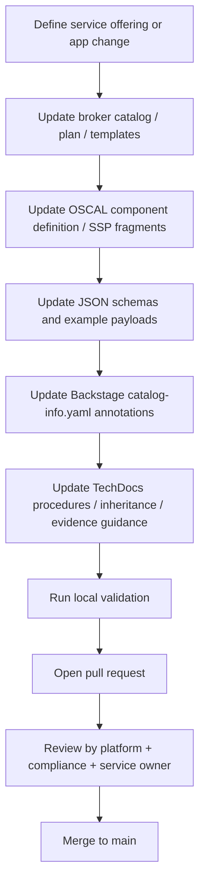
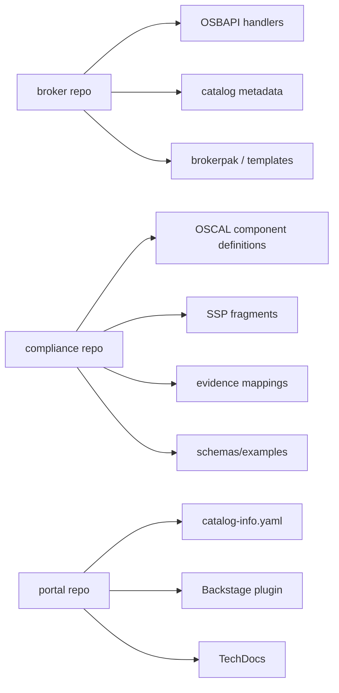
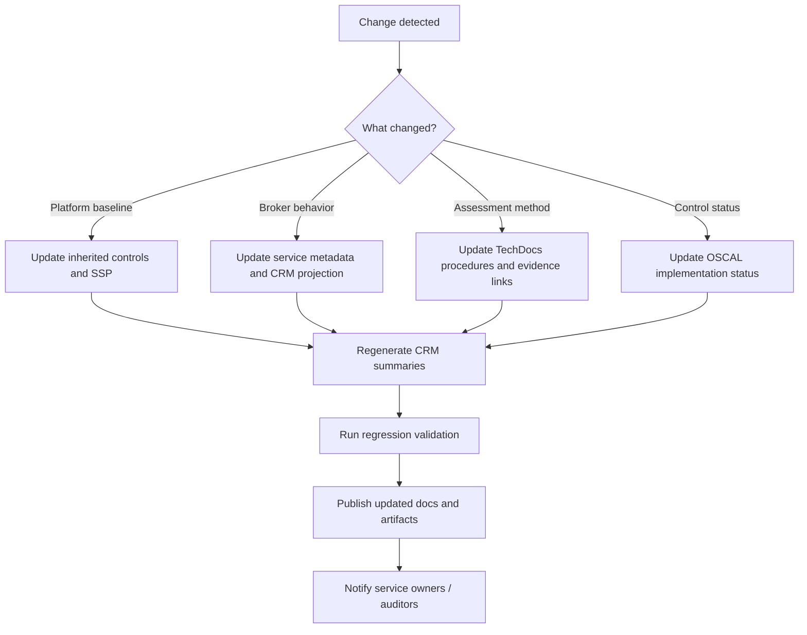
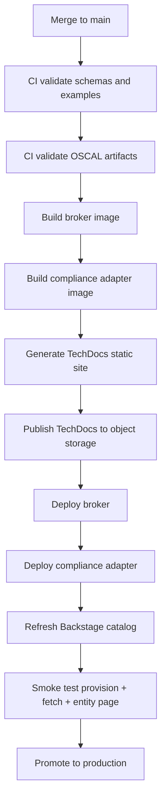
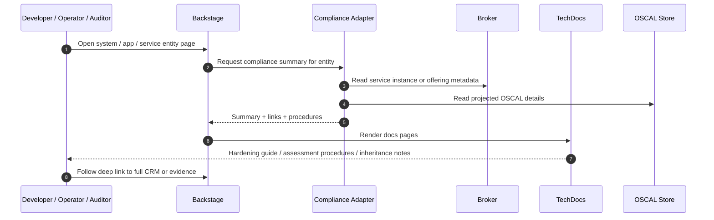
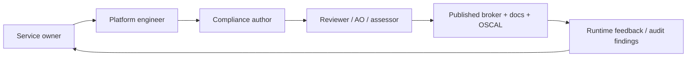
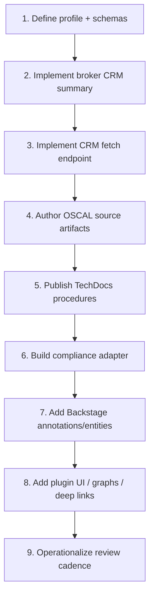

# Workflow Sequences — Development, Maintenance, Deployment, and End Usage

This workflow sequence assumes a minimal-footprint architecture where authoritative compliance content stays in OSCAL source artifacts, Backstage provides catalog and TechDocs UX, and the broker plus compliance adapter project the runtime and compliance state into consumable views [web:122][web:134][web:95].

## 1. Development workflow

The development path should be docs-as-code and schema-first, because TechDocs is designed to keep documentation close to code and publish from repository content through CI [web:122][web:77][web:134].

### 1.1 Detailed steps

1. Define the scope of the change, such as a new brokered service, a new plan, or an updated control implementation statement.
2. Update broker implementation artifacts, including OSB catalog metadata, plan schemas, and any provisioning templates or brokerpak defaults.
3. Update OSCAL artifacts first for control truth, including component definitions, SSP `implemented-requirement` content, inherited/exportable flags, and assessment procedures.
4. Update the projection layer, including JSON Schemas, sample broker responses, and any adapter mappings from OSCAL state into CRM summary fields.
5. Update Backstage metadata, usually `catalog-info.yaml` annotations and relations, plus TechDocs pages for operator and auditor-facing documentation [web:72][web:122][web:77].
6. Validate locally: JSON Schema validation, OSCAL validation if available in your toolchain, broker API tests, and TechDocs preview with `techdocs-cli serve` [web:77].

### 1.2 Suggested repo split

This split keeps runtime, compliance source-of-truth, and portal UX loosely coupled while still allowing coordinated pull requests across repos when a service changes [web:122][web:134].

## 2. Maintenance workflow

Maintenance should treat OSCAL and docs as living assets, not one-time onboarding artifacts, because TechDocs and OSCAL are both meant to evolve alongside system changes [web:122][web:129].

### 2.1 Maintenance triggers

- New cloud provider defaults or brokerpak updates.
- New FedRAMP, NIST, or internal control interpretation.
- New service plan or retirement of an old one.
- Failed assessment, drift detection, or evidence expiration.
- App onboarding or offboarding from brokered services.

### 2.2 Recommended cadence

- Per-change updates for broker code, catalog metadata, and TechDocs.
- Scheduled compliance refresh for OSCAL summaries and evidence links, such as daily or weekly depending on how dynamic the environment is.
- Periodic full assessment review, such as monthly or quarterly, to confirm implementation status and exportable/inherited relationships still match reality.

## 3. Deployment workflow

TechDocs has a standard prepare-generate-publish pipeline, and that fits well with a broader deployment process where broker, adapter, and docs publish independently but from the same source changes [web:123][web:134].

### 3.1 Deployment responsibilities

- **Broker deployment:** publish the updated catalog and provision/fetch behavior.
- **Compliance adapter deployment:** publish normalized APIs that Backstage uses for entity pages and summaries.
- **TechDocs deployment:** generate and publish docs to supported storage so Backstage can serve them [web:134].
- **Backstage deployment:** usually small unless a new plugin capability is needed; often only catalog refresh is needed if annotations and docs changed [web:122][web:134].

### 3.2 Smoke test sequence

1. Register or refresh the Backstage entity.
2. Confirm TechDocs renders the updated procedures page.
3. Provision a sample service instance through the broker.
4. Verify the provision response contains `metadata.attributes.oscal_crm`.
5. Query the CRM fetch endpoint and verify the detailed response.
6. Open the Backstage entity and confirm summary controls, deep links, and evidence references all resolve.

## 4. End-user workflow

Backstage is the user-facing discovery and navigation layer, while the broker and compliance adapter provide operational and compliance data behind the scenes [web:122][web:75].

### 4.1 Developer journey

1. Search for a brokered service in Backstage.
2. Read service overview, dependencies, and TechDocs usage guidance.
3. Inspect the compliance summary before adopting the service.
4. Provision or request provisioning through the platform workflow.
5. Return to Backstage to review implementation status, inherited controls, and customer responsibilities.

### 4.2 Operator journey

1. Open the broker or service offering entity.
2. Check current implementation status and last assessed timestamp.
3. Use the CRM fetch endpoint or plugin detail page to inspect control-level mappings.
4. Follow TechDocs procedures for operational validation or troubleshooting.

### 4.3 Auditor journey

1. Open the platform system or specific service entity in Backstage.
2. Review summary controls and identify which are inherited, shared, or customer-configured.
3. Jump to assessment procedures and evidence links in TechDocs.
4. Retrieve the full OSCAL-shaped CRM document for machine-readable traceability.
5. Correlate the projected summary back to the authoritative OSCAL artifact and supporting evidence.

## 5. Lifecycle governance workflow

A governance lane helps keep runtime, compliance, and docs aligned over time.

### 5.1 Ownership model

- Service owner owns service semantics, plans, and consumer guidance.
- Platform engineer owns broker behavior, adapter mapping, and deployment.
- Compliance author owns OSCAL source artifacts, implementation narratives, and assessment procedures.
- Reviewer or assessor validates that the projected CRM state matches the source artifacts and actual environment.

## 6. Minimal-footprint operating model

To keep the footprint small, avoid duplicating the same content in all layers. Keep canonical control language in OSCAL, keep detailed human procedures in TechDocs, keep only summary metadata in broker responses, and keep Backstage entities thin with references and annotations [web:122][web:95][web:134].

### 6.1 Content placement rule

- **Broker:** short runtime summary for immediate platform use.
- **OSCAL:** canonical machine-readable control implementation source.
- **TechDocs:** rich human-readable procedures, inheritance narratives, and operator guidance.
- **Backstage entity:** identifiers, links, relationships, and current status pointer.
- **Adapter:** translation and join layer, not long-term source-of-truth.

## 7. Recommended rollout order

This order reduces risk because the broker contract and OSCAL source-of-truth are proven before you invest in richer Backstage presentation layers [web:95][web:122].
